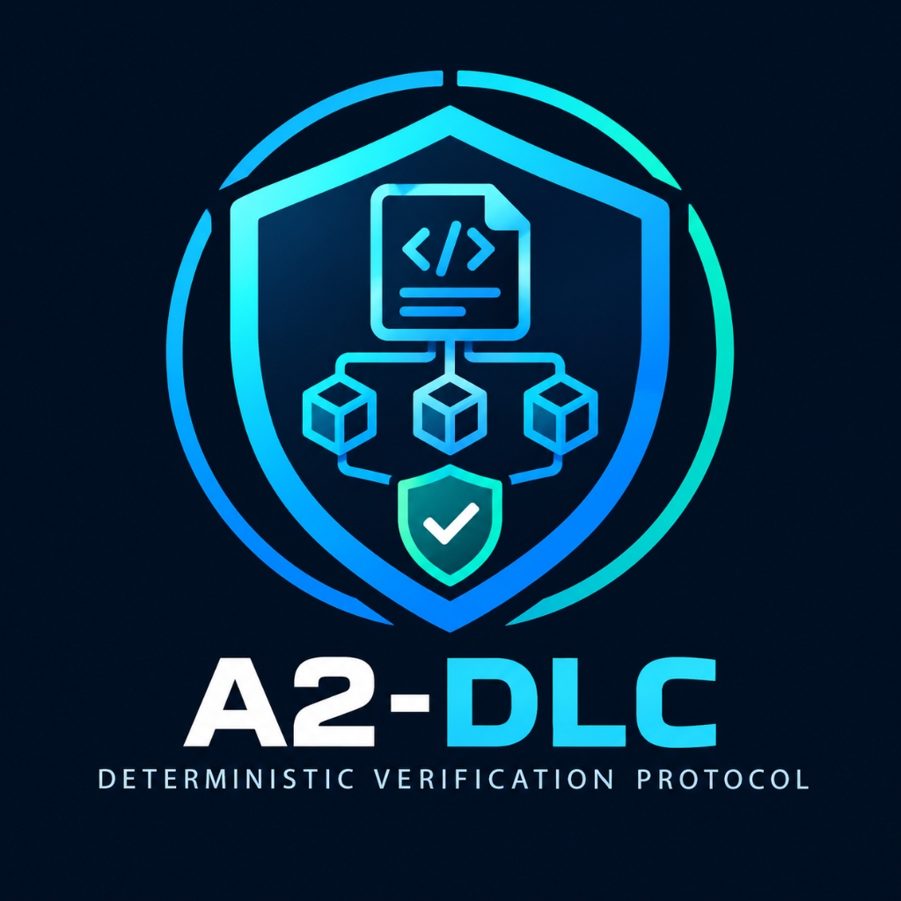
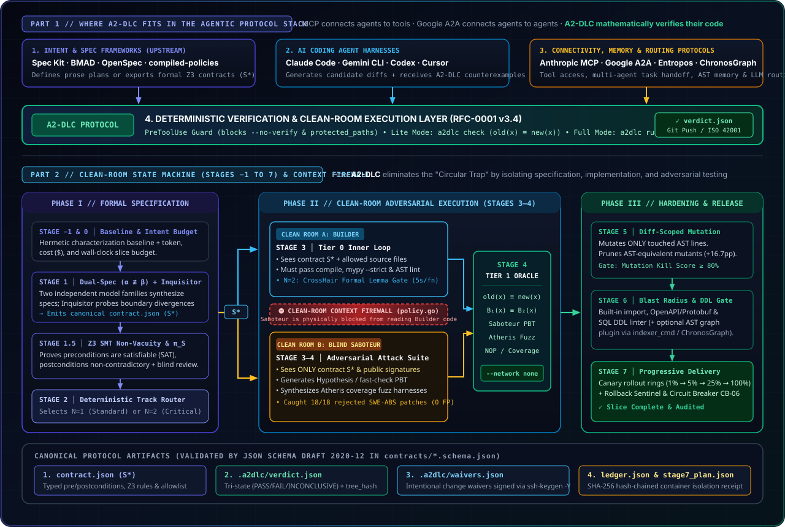

<p align="center">
  
</p>

<h1 align="center">A2-DLC</h1>

<p align="center"><b>Your AI agent wrote the bug — and the test that hides it.<br>A2-DLC finds the input that proves it, and blocks the push.</b></p>

<p align="center">
  <a href="https://github.com/falsable/a2dlc/releases"></a>
  <a href="https://github.com/falsable/a2dlc/actions"></a>
  <a href="docs/A2-DLC_v3.5_protocol.md"></a>
  <a href="LICENSE"></a>
  <a href="skills/a2dlc/SKILL.md"></a>
</p>

<p align="center">
  <a href="#try-it-in-60-seconds">Try it in 60 seconds</a> ·
  <a href="#how-it-works">How it works</a> ·
  <a href="#hook-it-into-your-agent">Claude Code / Gemini / Cursor / MCP</a> ·
  <a href="#does-it-actually-catch-anything">Benchmarks</a> ·
  <a href="docs/A2-DLC_v3.5_protocol.md">Spec</a>
</p>

<!-- TODO: record with asciinema/vhs → docs/assets/demo.gif (see examples/quickstart/) -->
<p align="center"></p>

```
$ a2dlc check
FAIL: 1 target, 6 changed lines examined
  ✗ src/pricing.py::apply_discount   (crosshair diffbehavior, 10.4s)
    counterexample: args=(100, 101) -> old=0, new=-1
```

That is a real refactor an agent called "equivalent". Its own tests were green. The old version clamped negative totals to 0; the new one returns `-1`. No LLM graded this — a symbolic execution engine searched for an input where `old(x) ≠ new(x)` inside a `--network none` container, and found one.

---

## The problem: the Circular Trap

Every agentic framework (Spec Kit, BMAD, OpenSpec, Superpowers) ends the turn the same way: **the model that wrote the code decides whether the code is right.** When it misunderstands the spec, it writes the bug into the implementation *and* into the test, and both pass. Review by a second prompt doesn't help — it shares the same context and the same blind spot.

A2-DLC replaces self-grading with **executable evidence**:

| Question | Who answers it today | Who answers it with A2-DLC |
|---|---|---|
| Did this refactor change behavior? | the agent ("no, it's equivalent") | CrossHair / fast-check / black-box oracle — with a counterexample |
| Does this new test actually test anything? | the agent ("yes, it passes") | the test is run against the *base* tree; if it still passes, it has no teeth |
| Was every changed line exercised? | nobody | coverage precondition — unexamined lines block the gate |
| Was the verdict tampered with? | nobody | receipt bound to the Git `tree_hash`, waivers signed with your SSH key |

`PASS` means *no divergence found within the recorded search budget* — a bounded search, not a proof. Everything it could not decide is handed to a human as a concrete, reproducible question, not a vibe.

---

## Try it in 60 seconds

Requires Git and Docker. The engines run inside hermetic containers; nothing talks to the network.

```bash
# 1. Install the single binary (+ bundled agent skill)
curl -fsSL https://raw.githubusercontent.com/falsable/a2dlc/main/install.sh | sh     # Linux / macOS / WSL
irm https://raw.githubusercontent.com/falsable/a2dlc/main/install.ps1 | iex          # Windows

# 2. Run the seeded-bug demo
git clone https://github.com/falsable/a2dlc && cd a2dlc/examples/quickstart
./demo.sh
```

You will see the gate **FAIL** on a refactor that silently changed behavior, print the counterexample, then **PASS** once the fix is applied. Then do it on your own repo:

```bash
cd your-repo
a2dlc install --agent claude     # or --agent gemini; auto-detects Python / TypeScript
a2dlc check                      # exit 0 PASS · 1 FAIL · 2 INCONCLUSIVE
```

---

## How it works

**1. Differential gate (`a2dlc check`)** — extracts every changed function from `git diff` and searches for an input where `old(x) ≠ new(x)`:
- Python → [CrossHair](https://github.com/pschanely/CrossHair) symbolic execution (`diffbehavior`)
- TypeScript → [fast-check](https://github.com/dubzzz/fast-check) property-based testing
- Go / any CLI → black-box I/O oracle

Plus test gates: *no-op test* detection (passes on the base tree), coverage precondition on changed lines, dependency allowlist. Output is `.a2dlc/verdict.json`, hash-bound to the Git tree it judged.

**2. Agent lifecycle hooks** — `PreToolUse` blocks edits to `protected_paths` and `git push --no-verify` *before* they run; the `Stop` / `AfterAgent` hook runs the gate at end of turn and feeds `args / old / new` back to the agent until it passes. `pre-push` runs `a2dlc verify` (<50 ms) so a stale or forged receipt never reaches the remote.

**3. Intentional changes are signed, not argued** — the agent declares the change in `.a2dlc/waivers.json`; a human signs it with `a2dlc approve src/pricing.py::apply_discount --key ~/.ssh/id_ed25519`. Agents never hold the key. A behavior change the engines find in code your `.a2dlc/config.json` does not list under `critical_code` is only a note in the receipt, with its counterexample; on critical code it fails until signed ([docs/DIVERGENCE_NOTES.md](docs/DIVERGENCE_NOTES.md)).

<details>
<summary><b>4. Full Protocol Mode (<code>a2dlc run</code>) — the clean-room state machine</b></summary>

For autonomous slices, A2-DLC orchestrates isolated container roles so no single model sees the whole picture: dual **Specifiers** (α ≢ β) write the spec independently, an **Inquisitor** probes the boundaries, **Z3** checks invariants, clean-room **Builders** implement with lemma gates, and a blind **Saboteur** attacks the code from public signatures without ever seeing the implementation. Stages −1 to 7 end with diff-scoped mutation testing, blast-radius analysis (imports, OpenAPI, Protobuf, SQL DDL) and a canary rollback plan. Every stage writes to a SHA-256 hash-chained `ledger.json` verified by `a2dlc verify-run`.

Measured: a greenfield slice converges in 84–127 s across 6–8 role containers at **$0.025–$0.069 per slice** (Claude Haiku 4.5 + Gemini 2.5 Flash). Full reference in the [spec](docs/A2-DLC_v3.5_protocol.md) and [coverage matrix](docs/COVERAGE_AND_BENCHMARKS.md).
</details>

<p align="center"></p>

---

## Hook it into your agent

| Harness | Setup | What gets wired |
|---|---|---|
| **Claude Code** | `a2dlc install --agent claude` | `.a2dlc/config.json`, `pre-push`, `.claude/settings.json` (`PreToolUse` + `Stop`) |
| **Gemini CLI / Antigravity** | `a2dlc install --agent gemini` | same + `.gemini/settings.json` (`PreToolUse` + `AfterAgent`) |
| **Codex / Cursor / Copilot** | `a2dlc install` + [`SKILL.md`](skills/a2dlc/SKILL.md) | `pre-push`; the agent runs `a2dlc check` per the skill |
| **Any MCP client** | `"a2dlc": { "command": "a2dlc", "args": ["mcp"] }` | `a2dlc_status`, `a2dlc_check`, `a2dlc_verify`, `a2dlc_verify_run`, `a2dlc_format_report` |
| **Skill registries** | `npx skills add falsable/a2dlc` · `agy plugin install https://github.com/falsable/a2dlc` | bundled `SKILL.md` |

Or paste this to your agent:

```
Install A2-DLC here: run the install script from https://github.com/falsable/a2dlc,
read .claude/skills/a2dlc/SKILL.md, run `a2dlc install --agent claude`, then `a2dlc check`
and resolve every FAIL or INCONCLUSIVE target in .a2dlc/verdict.json.
```

Works underneath Spec Kit, BMAD, OpenSpec or Superpowers: they structure the prompts, A2-DLC verifies the output.

---

## Does it actually catch anything?

All numbers come from frozen mutants (`e2e/testdata/`, pinned by SHA-256) and fixed seeds. Methodology, Wilson 95% intervals and per-stage coverage: [`docs/COVERAGE_AND_BENCHMARKS.md`](docs/COVERAGE_AND_BENCHMARKS.md).

| Benchmark | Result |
|---|---|
| **SWE-bench Verified** — 38 real agent patches (18 rejected by maintainers, 20 accepted) | CrossHair alone: **0/18** caught. Repo tests + coverage precondition + Saboteur overlay: **18/18 caught (100%, CI 82–100%)**, **0/20 false positives** |
| **"Every session verifies its own work"** (ADLC rule) vs `a2dlc check`, 9 frozen trees | Self-verification lets **3/5** blocking cases through; the gate blocks **5/5**, passes **4/4** |
| TypeScript engine — 8 frozen mutants + 1 equivalent refactor, seeds 1–3 | **8/8** caught on every seed; refactor `PASS` |
| Black-box engine — 5 mutants of `internal/verdict` + 1 equivalent refactor | **5/5** caught in 8–12 s; refactor `PASS` |
| Equivalent-mutant pruning (`mutmut`, `billing.py`) | kill rate **48.9% → 65.6%** after pruning 13 equivalent mutants |
| Test & property gates — 12 frozen cases | **12/12** judged as expected; every receipt validates against the JSON Schemas |

The gate also gates this repo: every push to `main` runs `a2dlc check` against a pinned, hash-verified release of itself ([`.github/workflows/a2dlc.yml`](.github/workflows/a2dlc.yml)).

---

## How it compares

| | Spec Kit · BMAD · OpenSpec · Superpowers · AI-DLC | **A2-DLC** |
|---|---|---|
| Primary mechanism | Markdown plans, personas, prompt skills | Go state machine + `--network none` Docker engines |
| Who grades the code | the agent, or a human reading `tasks.md` | symbolic execution, PBT, Z3, fuzzing, mutation |
| Same agent writes code + test | ✗ undefended | ✓ clean-room roles, blind Saboteur |
| Refactor equivalence (`old(x) ≡ new(x)`) | ✗ | ✓ native, per function, with counterexample |
| Anti-bypass | ✗ | ✓ `tree_hash`-bound receipt, hook guard, SSH-signed waivers |

Stage-by-stage against classic SDLC and ADLC: [`docs/VS_SDLC_AND_ADLC.md`](docs/VS_SDLC_AND_ADLC.md).

---

## CLI reference

| Command | Purpose |
|---|---|
| `a2dlc install [--agent claude] [--agent gemini]` | Config, `pre-push` hook, agent lifecycle hooks |
| `a2dlc check [--base <ref>] [--peer <ref>]` | Differential + test gates → `.a2dlc/verdict.json` |
| `a2dlc verify [--commit HEAD]` | <50 ms: receipt is `PASS`, matches `tree_hash`, waivers signed |
| `a2dlc approve <file>::<symbol> --key <key>` | Sign an intentional behavior change (`ssh-keygen -Y`) |
| `a2dlc run --slice <id> --intent <file>` | Full Protocol Mode, Stages −1 to 7 |
| `a2dlc verify-run --slice <id>` | Verify the hash-chained container ledger |
| `a2dlc answer --slice <id> --probe <id> --choice alpha` | Answer a human probe and resume |
| `a2dlc mcp` | Built-in MCP server (JSON-RPC 2.0 over stdio) |

<details>
<summary><b>Enterprise: Jira · Linear · GitHub · GitLab · Confluence · Slack via MCP / Composio</b></summary>

The engines never touch the network, but the protocol plugs into your SDLC through MCP connectors and CI:

```
ticket / PRD ──► a2dlc_intent_from_ticket ──► intent.json (Stage 0)
                        │
                 a2dlc run / check  (clean-room, --network none)
                        │
             a2dlc_format_report ──► PR / MR / Jira / Linear / Confluence comment
                        │
       CI: a2dlc verify --commit HEAD ──► ISO 42001 / EU AI Act audit package
                        │
   canary alert ──► a2dlc_intent_from_signal ──► bugfix intent, same invariants & budget cap
```

A CI template lives in [`templates/ci/`](templates/ci). Example multi-server MCP config:

```json
{ "mcpServers": {
    "a2dlc":    { "command": "a2dlc", "args": ["mcp"] },
    "composio": { "command": "npx", "args": ["-y", "@composio/mcp@latest", "--apps", "jira,linear,github,gitlab,confluence,slack"] } } }
```
</details>

<details>
<summary><b>Optional companions (zero lock-in)</b></summary>

A2-DLC needs only the `a2dlc` binary, Git and Docker, and works with your existing Claude, Gemini or OpenRouter keys. Sibling projects connect through open JSON contracts and are strictly optional: [`Entropos`](https://github.com/falsable/Entropos) (entropy-based LLM routing), [`compiled-policies`](https://github.com/falsable/compiled-policies) (Z3 business-policy compilation), `ChronosGraph` (cross-repo AST graphs, public soon).
</details>

---

## Docs

- [Protocol specification — RFC-0001 v3.5](docs/A2-DLC_v3.5_protocol.md)
- [Coverage matrix, stage reference, deviations & benchmarks](docs/COVERAGE_AND_BENCHMARKS.md)
- [Agent skill](skills/a2dlc/SKILL.md) · [JSON Schema contracts](contracts)
- [Quickstart example](examples/quickstart)

## Contributing

Bug reports with a frozen mutant are the most valuable thing you can send: see [`e2e/testdata/`](e2e/testdata) for the format. Engines for new languages implement the contract in [`contracts/`](contracts) — Rust and Java are the most requested. Open a Discussion if you want to add one.

Project policies: [CONTRIBUTING](CONTRIBUTING.md) · [GOVERNANCE](GOVERNANCE.md) · [SECURITY](SECURITY.md) · [Compatibility](docs/COMPATIBILITY.md) · [Name and conformance](docs/NAME_AND_CONFORMANCE.md) · [Conformance kit](conformance/README.md) · [RFCs](rfcs/README.md)

## License

[Apache-2.0](LICENSE) · © 2026 Aldemar Hernández · [falsable](https://github.com/falsable)
