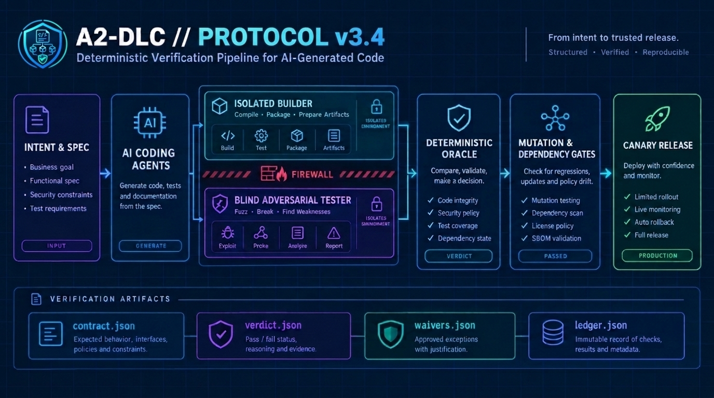

<div align="center">


# A2-DLC — Autonomous Agent-Driven Development Lifecycle Protocol

[-6366f1.svg?style=flat-square)](docs/A2-DLC_v3.4_protocol.md)
[](https://github.com/falsable/a2dlc/releases)
[](LICENSE)
[](go.mod)
[](skills/a2dlc/SKILL.md)

<p align="center">
  <a href="#what-is-the-a2-dlc-protocol"><b>What is the A2-DLC Protocol?</b></a> •
  <a href="#see-it-in-action"><b>See It in Action</b></a> •
  <a href="#1-step-install--pick-your-harness"><b>🤖 Install &amp; Harnesses</b></a> •
  <a href="#how-a2-dlc-compares-to-existing-protocols"><b>vs. Spec Kit / BMAD / AI-DLC</b></a> •
  <a href="docs/A2-DLC_v3.4_protocol.md"><b>Protocol Spec (RFC-0001)</b></a> •
  <a href="docs/COVERAGE_AND_BENCHMARKS.md"><b>Benchmarks &amp; Deep Dive</b></a>
</p>



</div>

---

## What is the `A2-DLC` Protocol?

**`A2-DLC` (*Autonomous Agent-Driven Development Lifecycle*, [RFC-0001 v3.4](docs/A2-DLC_v3.4_protocol.md)) is an open verification protocol and deterministic 9-stage state machine for AI-generated software.** This repository provides both the formal protocol specification and the **`a2dlc` CLI reference implementation**—a language-agnostic verification gate that blocks an AI coding agent's commit or push when it finds an undeclared behavior change, a test that would pass without the change, or changed code that no check looked at.

First-generation agentic frameworks (`Spec Kit`, `BMAD`, `OpenSpec`, `Superpowers`) structure *prompts and Markdown plans*, but still trust the LLM at the end of the turn—falling into the **Circular Trap** where the same agent writes a bug in the code and the same bug in the test. **The `A2-DLC` protocol replaces LLM self-grading with executable checks and context isolation, and narrows human review to the behavior changes the gate cannot decide on its own**:

1. **Lite Mode — Differential Execution Gate (`a2dlc check`):** Extracts every changed function from `git diff` and searches for an input where `old(x) ≠ new(x)` (`CrossHair` symbolic execution for Python, `fast-check` property testing for TypeScript, black-box I/O oracle for Go/CLI) inside hermetic (`--network none`) Docker containers, writing a receipt (`.a2dlc/verdict.json`) bound by hash to the Git `tree_hash`. A `PASS` means no difference was found within the recorded search budget: a bounded search, not a proof of equivalence ([spec §6.4 and §10](docs/A2-DLC_v3.4_protocol.md#64-verdict-and-waives-common-to-lite-and-full)).
2. **Proactive & End-of-Turn Agent Lifecycle Hooks:** The `PreToolUse` hook intercepts attempts to edit `protected_paths` or run `git push --no-verify` *before* execution, and the end-of-turn hook (`Stop` / `AfterAgent`) runs `a2dlc check` automatically, returning concrete counterexamples (`args`, `old`, `new`) to your agent until the gate passes.
3. **Full Protocol Mode — Clean-Room Autonomous State Machine (`a2dlc run`, Stages −1 to 7):** Orchestrates isolated container roles—dual Specifiers ($\alpha \not\equiv \beta$), an Inquisitor, Z3 SMT invariant checks, clean-room Builders with lemma gates, a blind **Saboteur** that attacks the code from public signatures without seeing its implementation, diff-scoped mutation testing, built-in import/OpenAPI/Protobuf/SQL-DDL blast-radius checks (with optional AST graph plugin support via `indexer_cmd`), and canary rollback plans.

> **100% Standalone & Zero Lock-In:** `A2-DLC` requires **only** the `a2dlc` single binary, Git, and Docker. It works out of the box with your existing `Claude`, `Gemini`, or `OpenRouter` keys and includes its own built-in import/OpenAPI/Protobuf discovery and SQL DDL linter. Companion tools in the [`falsable`](https://github.com/falsable) ecosystem ([`ChronosGraph`](https://github.com/falsable/chronosgraph) for deep cross-repo AST graphs, [`Entropos`](https://github.com/falsable/Entropos) for Shannon-entropy LLM routing, and [`compiled-policies`](https://github.com/falsable/compiled-policies) for Z3 business policy compilation) are **strictly optional plugins** connected via open JSON contracts.

---

## See It in Action

```text
Agent: I refactored `apply_discount(price: int, discount: int) -> int` in `src/pricing.py`.
       [End of turn -> A2-DLC hook automatically runs `a2dlc check` in --network none sandbox]

$ a2dlc check
FAIL: 1 targets, 0 tests judged, 0 out of scope, 6 changed lines examined
  ✗ src/pricing.py::apply_discount  (engine: python / crosshair diffbehavior, 10.4s)
    counterexample: args=(100, 101) -> old=0, new=-1
    escalation: behavior_divergence written to .a2dlc/escalations.json

[Hook blocks agent turn (exit 2) and feeds counterexample back to the agent]

Agent: Caught it — `old` clamped negative totals to 0 when `discount > price`.
       Fixed `max(0, price - discount)` and re-running `a2dlc check`:

$ a2dlc check
PASS: 1 targets, 0 tests judged, 0 out of scope, 6 changed lines examined and 0 not examined
Receipt written to .a2dlc/verdict.json (bound to git-tree:8f94e2c1...)

$ git push
a2dlc verify: ok
```

*(If the behavior change was intentional, the agent declares it in `.a2dlc/waivers.json` and the human signs it with `a2dlc approve src/pricing.py::apply_discount --key ~/.config/a2dlc/firma`).*

---

## 1-Step Install & Pick Your Harness

### 1. Install `A2-DLC` (CLI Binary + Bundled Agent Skill)

**Linux, macOS, or WSL:**
```bash
curl -fsSL https://raw.githubusercontent.com/falsable/a2dlc/main/install.sh | sh
```

**Windows PowerShell:**
```powershell
irm https://raw.githubusercontent.com/falsable/a2dlc/main/install.ps1 | iex
```

**Install the Agent Skill (`SKILL.md`) via `skills` CLI or Antigravity:**
```bash
npx skills add falsable/a2dlc
# Or in Google Antigravity (agy):
agy plugin install https://github.com/falsable/a2dlc
```

### 2. Pick Your Agent Harness (Hooks, Skill, or MCP Server)

| Agent Harness | Configure in Your Repo | What Gets Wired Automatically |
| :--- | :--- | :--- |
| **Claude Code** | `a2dlc install --agent claude` | `.a2dlc/config.json`, `pre-push` hook, `.claude/settings.json` (`PreToolUse` + `Stop` hooks) |
| **Gemini CLI / Antigravity** | `a2dlc install --agent gemini` | `.a2dlc/config.json`, `pre-push` hook, `.gemini/settings.json` (`PreToolUse` + `AfterAgent` hooks) |
| **Codex CLI / Cursor / Copilot** | `a2dlc install` + [`skills/a2dlc/SKILL.md`](skills/a2dlc/SKILL.md) | `.a2dlc/config.json`, `pre-push` (`a2dlc verify`; the agent runs `a2dlc check` per the skill), and `.agents/skills/a2dlc/SKILL.md` |
| **MCP Clients (Cursor, Windsurf, Claude Desktop)** | `"mcpServers": { "a2dlc": { "command": "a2dlc", "args": ["mcp"] } }` | Exposes JSON-RPC 2.0 `stdio` tools: `a2dlc_status`, `a2dlc_check`, `a2dlc_verify`, `a2dlc_verify_run` |

### 3. Or Copy-Paste This Directly to Your Agent

Paste this single instruction into **Claude Code**, **Gemini CLI**, **Codex**, or **Cursor**:

```text
Install and configure A2-DLC in this repository:
1. Run `curl -fsSL https://raw.githubusercontent.com/falsable/a2dlc/main/install.sh | sh` (or `irm https://raw.githubusercontent.com/falsable/a2dlc/main/install.ps1 | iex` on Windows) to install the verified a2dlc binary and `.claude/skills/a2dlc/SKILL.md`.
2. Read `.claude/skills/a2dlc/SKILL.md` and run `a2dlc install --agent claude --agent gemini`.
3. Run `a2dlc check` and resolve any `FAIL` or `INCONCLUSIVE` targets in `.a2dlc/verdict.json`.
```

---

## How `A2-DLC` Compares to Existing Protocols

`A2-DLC` can be used standalone (`a2dlc run`) **or** underneath any spec/prompt framework (`Spec Kit`, `BMAD`, `OpenSpec`, `Superpowers`) as the deterministic verification gate that checks their output against the base and the spec:

| Dimension | `github/spec-kit` | `BMAD-METHOD` | `Fission-AI/OpenSpec` | `obra/superpowers` | `awslabs/aidlc-workflows` | **`falsable/a2dlc` (`A2-DLC v3.4`)** |
| :--- | :--- | :--- | :--- | :--- | :--- | :--- |
| **Primary Mechanism** | Markdown templates (`spec.md`, `plan.md`) | Multi-agent Agile personas in prompts | Change folders (`propose → apply`) | Prompt skills (TDD, YAGNI) + subagents | 33-stage workflow rules + human gates | **Deterministic Go state machine + `--network none` Docker engines** |
| **Who Grades the Code?** | Agent / Human | "QA" prompt persona / Human | Human reviewing `tasks.md` | Subagent + same-agent TDD | Human approval gates | **Symbolic Execution (`CrossHair`), PBT (`fast-check`), `Z3` SMT, `Atheris` Fuzzer & AST Mutation** |
| **Defends Against Circular Trap (Same Agent Writes Code + Test)?** | ❌ No | ❌ No | ❌ No | ❌ No | ❌ No | ✅ **Clean-Room Isolation (`policy.go`):** Blind *Saboteur* attacks from public signatures without seeing *Builder* code |
| **Refactor Equivalence Check (`old(x) ≡ new(x)`, bounded search)** | ❌ No | ❌ No | ❌ No | ❌ No | ❌ No | ✅ **Native (`a2dlc check`):** Rewrites base imports and compares base vs. candidate per function |
| **Hash-Bound Receipt & Anti-Bypass** | ❌ None | ❌ None | ❌ None | ❌ None | Local event log | ✅ **`tree_hash` bound `.a2dlc/verdict.json` + `PreToolUse` guard + SSH-signed waivers (`ssh-keygen -Y`)** |

Against the classic SDLC and the "Agentic Development Lifecycle" (ADLC) drawn in the "From SDLC to ADLC" infographic, stage by stage and artifact by artifact, with the test behind each row: [`docs/VS_SDLC_AND_ADLC.md`](docs/VS_SDLC_AND_ADLC.md).

---

## Protocol Architecture & Clean-Room State Machine (`Stages −1 to 7`)

Just as **Anthropic MCP** standardizes how agents connect to tools and **Google A2A** standardizes how agents delegate tasks to other agents, **`A2-DLC` (RFC-0001 v3.4) standardizes how agent-generated code is checked by execution, isolated, and bound to the Git tree it was judged on before reaching Git or production**:

<div align="center">


</div>

### Core CLI Commands & Protocol Primitives

| Command / Artifact | Role in the `A2-DLC` Protocol |
| :--- | :--- |
| `a2dlc install [--agent claude] [--agent gemini]` | Initializes `.a2dlc/config.json`, the `pre-push` git hook (commits are never blocked, so agents' worktrees merge freely; the push is the gate), and proactive/reactive agent lifecycle hooks (`PreToolUse`, `Stop`, `AfterAgent`). |
| `a2dlc check [--base <ref>] [--peer <ref>]` | **Lite Mode Gate (§4.4):** Runs differential engines (`engines/{py,ts,blackbox}`) and test gates (NOP/Oracle, baseline, coverage precondition); emits `.a2dlc/verdict.json` bound to `tree_hash`. |
| `a2dlc verify [--commit HEAD]` | Verifies in `<50 ms` that `.a2dlc/verdict.json` is `PASS`, matches the current git `tree_hash`, and carries valid SSH signatures for any waiver. |
| `a2dlc approve <file>::<symbol> --key <key>` | Cryptographically signs an intentional behavioral change in `.a2dlc/waivers.json` using `ssh-keygen -Y` (`a2dlc-approval` namespace). |
| `a2dlc run --slice <id> --intent <file>` | **Full Protocol Mode (Stages −1 to 7):** Orchestrates clean-room containerized roles (`Specifier α/β`, `Inquisitor`, `Builder`, `Saboteur`) via `claude`, `gemini`, `openrouter`, or [`Entropos`](https://github.com/falsable/Entropos) (`A2DLC_LLM=entropos`). |
| `a2dlc verify-run --slice <id>` | Verifies the SHA-256 hash-chained container isolation receipt (`ledger.json`), budget enforcement, and Stage −1..7 artifacts. |
| `a2dlc mcp` | Starts the built-in **Model Context Protocol (MCP)** JSON-RPC 2.0 `stdio` server (`a2dlc_status`, `a2dlc_check`, `a2dlc_verify`, `a2dlc_verify_run`, `a2dlc_intent_from_ticket`, `a2dlc_intent_from_signal`, `a2dlc_format_report`). |

---

## 🏢 Enterprise SDLC & Connector Ecosystem (`Jira` · `Linear` · `GitHub` · `GitLab` · `Confluence` · `Composio`)

While `A2-DLC`'s verification engines run inside strict `--network none` sandboxes so they can never leak secrets or hallucinate external calls, the protocol integrates with your enterprise engineering stack through **MCP / Composio connectors** and **CI/CD gates**:

```text
[Jira / Linear / Confluence / GitHub Issues]
       │  (Fetched by Agent via Composio MCP or Official Vendor MCP)
       ▼
  a2dlc_intent_from_ticket  ──►  .a2dlc/intents/<slice>.intent.json (Stage 0 Schema-Validated)
       │
       ▼
  a2dlc run / a2dlc check   ──►  Clean-Room Verification in --network none Docker Sandbox
       │
       ▼
  a2dlc_format_report       ──►  Posts Verified Receipt & Counterexamples to GitHub PR / GitLab MR / Jira / Linear / Confluence
       │
       ▼
  GitHub Actions / GitLab CI (`a2dlc verify --commit HEAD`)  ──►  ISO 42001 / EU AI Act Audit Package (Agora Core)
       │
       ▼
  Rollback Sentinel alert (Stage 7 ring)  ──►  a2dlc_intent_from_signal  ──►  new bugfix intent, same invariants, boundary and budget cap
```

| Enterprise System | How It Connects to `A2-DLC` | What It Automates |
| :--- | :--- | :--- |
| **Jira & Confluence** *(Atlassian MCP / [Composio](https://composio.dev))* | Agent reads Jira ticket / Confluence PRD $\rightarrow$ calls `a2dlc_intent_from_ticket` $\rightarrow$ posts `a2dlc_format_report` back to Jira/Confluence | Turns prose tickets & PRDs into Stage 0 `intent.json` contracts with budget caps (`max_cost_usd`) and attaches cryptographic verification tables to the ticket |
| **Linear** *(Linear MCP `mcp.linear.app` / Composio)* | Agent ingests Linear issue acceptance criteria & invariants $\rightarrow$ runs `a2dlc check` / `a2dlc run` $\rightarrow$ comments receipt on Linear | Blocks issues from moving to *In Review / Done* until `.a2dlc/verdict.json` is `PASS` and posts any Stage 1 Inquisitor boundary probes directly to the thread |
| **GitHub & GitLab** *(GitHub/GitLab MCP + CI/CD)* | `a2dlc verify --commit HEAD` in GitHub Actions / GitLab CI + PR/MR comments via `a2dlc_format_report` | Verifies in `<50 ms` that the PR/MR commit matches a signed `PASS` receipt (`tree_hash` bound) and displays per-function differential results on the PR |
| **Slack / PagerDuty / ServiceNow** *(Composio MCP)* | Routes `.a2dlc/escalations.json` (`behavior_divergence`, `spec_divergence`, Stage 7 `CB-06` canary alerts) | Delivers concrete counterexamples (`args`, `old`, `new`) to engineering channels for 1-command human waiver signing (`a2dlc approve`) or probe answers (`a2dlc answer`) |

**Example Multi-Server MCP Config (`mcp.json` for Cursor, Claude Code, Windsurf, or Gemini):**
```json
{
  "mcpServers": {
    "a2dlc": {
      "command": "a2dlc",
      "args": ["mcp"]
    },
    "composio": {
      "command": "npx",
      "args": ["-y", "@composio/mcp@latest", "--apps", "jira,linear,github,gitlab,confluence,slack"]
    }
  }
}
```

---

## Measured Results Summary

All measurements use frozen mutants (`e2e/testdata/` pinned by SHA-256 before engine evaluation) and fixed seeds. Full methodology, SWE-ABS Wilson 95% intervals, and per-stage coverage tables are in **[`docs/COVERAGE_AND_BENCHMARKS.md`](docs/COVERAGE_AND_BENCHMARKS.md)**.

| Suite / Benchmark | Setup | Measured Result |
| :--- | :--- | :--- |
| **SWE-ABS Benchmark: VARA 1 vs. VARA 2** (`e2e/bench-swe-abs/RESULTS.md`) | 10 SWE-bench Verified instances, 38 real agent patches (18 rejected, 20 accepted) | • *VARA 1 (CrossHair alone on top-level fns):* **`0/18` (`0%`) caught** (11 rejected patches passed empty)<br>• *VARA 2 Arm A1 (Repo tests + coverage precondition):* **`0/38` false empty passes**<br>• *VARA 2 Arm A2 (Saboteur overlay + peer oracle):* **`18/18` rejected patches caught (`100%` [82–100%])**, **`0/20` false positives** |
| **Autonomous Lifecycle Runs (`a2dlc run` Stages −1 to 7)** | Real LLM container execution (Claude Haiku 4.5 + Gemini 2.5 Flash) across greenfield & brownfield `N=1` and `N=2` slices | Converges in **`84 – 127 s`** across 6–8 isolated role containers at **`$0.025 – $0.069 USD` total cost per slice**; **`100%` (`2/2`)** diff-scoped mutant kill rate |
| **Stage 1 Retry & `N=2` Equivalence (`a2dlc run`)** | Same intent and role set (Claude Haiku 4.5 + Gemini 2.5 Flash), batches of 8 real runs (2026-10-21) | A rejected Specifier/Inquisitor answer gets one retry with the reason: Stage 1 **`4/8` $\rightarrow$ `8/8`**; with the engine declaring the symbols both candidates left identical, **`8/8` PASS**, and two-candidate runs went from **`0/5` to `4/4`** past `equivalence_s` (one fixture; details in the Stage 1 and `N=2` rows of the coverage doc) |
| **Stage 5 AST Equivalent-Mutant Pruning** (`e2e/measure_mutate.sh`) | `mutmut` on `billing.py` before vs. after `prune_equivalent.py` (docstring, `__all__`, type-annotation & logging filters) | Raw kill rate **`48.9%` (`22/45`) $\rightarrow$ `65.6%` (`21/32`)** (**`+16.7 pp`**, 13 equivalent mutants pruned) |
| **TypeScript Engine (`engines/ts`)** | 8 frozen mutants + 1 equivalent refactor (`fast-check` with domain generators, seeds 1–3) | **`8/8` mutants caught (`FAIL`)** on every seed; equivalent refactor `PASS` |
| **Black-Box Self-Gate (`engines/blackbox`)** | 5 frozen mutants of `internal/verdict` + 1 equivalent refactor | **`5/5` mutants caught (`FAIL` in 8–12s)**; equivalent refactor `PASS` |
| **Self-verification vs. the gate** ([`docs/VS_SDLC_AND_ADLC.md`](docs/VS_SDLC_AND_ADLC.md)) | The ADLC rule "every session verifies its own work" (`e2e/measure_self_verification.sh`, two readings: the test files the session changed, or the whole suite with the base's red tests discounted) against `a2dlc check`, same 9 frozen `gates-py` trees, real pytest | Self-verification lets **3 of the 5** blocking cases through on the changed-files reading and **2 of 5** on the suite reading (toothless test, unexamined method); `a2dlc check` blocks **5/5** and passes **4/4**, no false block |
| **Test & Property Gates (`gates-py`, `gates-prop`)** | 12 frozen cases (NOP/Oracle toothless tests, regressions, Hypothesis properties, waivers) | **`12/12` judged as expected**; all emitted receipts validate against JSON Schemas |
| **5-Repo Ecosystem Golden Thread E2E** *(internal)* | `compiled-policies` (`S*`) $\rightarrow$ `Entropos` + `a2dlc run` (Stages −1 to 7) + `ChronosGraph` Stage 6 AST $\rightarrow$ `verify-run` $\rightarrow$ ISO 42001 audit | **End-to-end `PASS` in ~11.2s** (`e2e/test_golden_thread_ecosystem.py`). Not reproducible from this repository alone: it needs sibling checkouts of the four other repos, one of them (`agencia-ia`) not public. |

---

## Documentation & Deep Dive

- **[Full Protocol Specification (RFC-0001 v3.4)](docs/A2-DLC_v3.4_protocol.md)**
- **[Protocol Coverage Matrix, Stage Reference, Deviations & Full Benchmarks](docs/COVERAGE_AND_BENCHMARKS.md)**
- **[Bundled Agent Skill (`skills/a2dlc/SKILL.md`)](skills/a2dlc/SKILL.md)**
- **[JSON Schema Contracts (`contracts/*.schema.json`)](contracts/)**

## License

[Apache-2.0](LICENSE). © 2026 Aldemar Hernández · [falsable](https://github.com/falsable).
