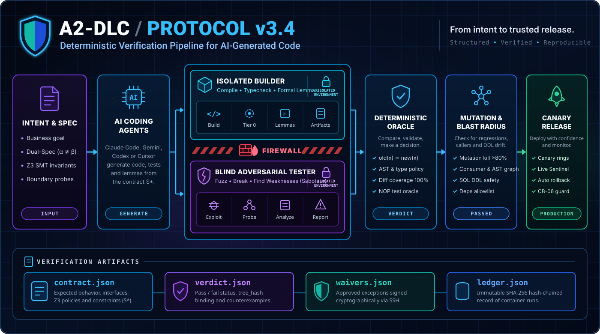

<div align="center">



<br>

[](A2-DLC_v3.5_protocol.md)
[](https://github.com/falsable/a2dlc/releases)
[](../LICENSE)
[](../go.mod)
[](../skills/a2dlc/SKILL.md)

<p align="center">
  <a href="#what-is-a2dlc"><b>What is a2dlc?</b></a> •
  <a href="#use-with-claude-code-gemini-cli-or-codex"><b>🤖 Use with Your AI Agent</b></a> •
  <a href="A2-DLC_v3.5_protocol.md"><b>Specification (RFC-0001)</b></a> •
  <a href="#quick-start"><b>Quick Start</b></a> •
  <a href="#the-state-machine-a2dlc-run"><b>State Machine</b></a> •
  <a href="#measured-results"><b>Benchmarks</b></a>
</p>

</div>

---

## What is `a2dlc`?

**`a2dlc` blocks an AI coding agent's commit or push when it finds an undeclared behavior change, a test that would pass without the change, or changed code that no check looked at.**

When you use **Claude Code**, **Gemini CLI**, **Codex**, or **Cursor**, reviewing thousands of lines of AI-generated diffs by eye does not scale—and letting the same agent write both the code and the unit tests creates a circular trap. **`a2dlc` replaces line-by-line diff review with a deterministic verification gate, and leaves the human the behavior changes it cannot decide**:

1. **Differential Execution (`a2dlc check`):** Extracts every changed function from `git diff` and searches for an input where `old(x) ≠ new(x)` across thousands of generated inputs (a bounded search, not a proof) (`CrossHair` symbolic execution for Python, `fast-check` property testing for TypeScript, black-box I/O oracle for Go/CLI) inside network-less (`--network none`) Docker containers.
2. **Proactive Agent Hooks (`PreToolUse` + End-of-Turn):** Blocks your agent *before* it can touch protected test suites (`protected_paths`) or run `git push --no-verify`, and automatically runs `a2dlc check` at the end of every agent turn, feeding concrete counterexamples (`args`, `old`, `new`) back to the agent until the gate passes.
3. **Full Autonomous Lifecycle (`a2dlc run`, Stages −1 to 7):** Orchestrates isolated container roles—dual Specifiers ($\alpha \not\equiv \beta$), an Inquisitor, Z3 SMT invariant checks, clean-room Builders with lemma gates, a blind Saboteur that attacks the code without seeing its implementation, diff-scoped mutation testing, AST blast-radius checks (`ChronosGraph`), and canary rollback plans.

---

## 🤖 Use with Claude Code, Gemini CLI, or Codex

`a2dlc` is designed to be operated **by your AI agent**. Copy and paste this instruction into **Claude Code**, **Gemini CLI / Antigravity**, **OpenAI Codex**, or **Cursor**:

```text
Install and configure a2dlc in this repository:
1. Download the latest a2dlc v0.4.1 binary for this OS from https://github.com/falsable/a2dlc/releases/latest (verify against SHA256SUMS) and place it on PATH.
2. Copy the official agent skill from https://raw.githubusercontent.com/falsable/a2dlc/main/skills/a2dlc/SKILL.md into `.agents/skills/a2dlc/SKILL.md` and `.claude/skills/a2dlc/SKILL.md`, and read it.
3. Run `a2dlc install --agent claude --agent gemini` to initialize `.a2dlc/config.json`, the `pre-push` git hook, and agent lifecycle hooks (`PreToolUse` and `Stop`/`AfterAgent`).
4. Run `a2dlc check` and resolve any `FAIL` or `INCONCLUSIVE` targets in `.a2dlc/verdict.json` following the skill instructions.
```

### Install the Bundled Agent Skill (`SKILL.md`) Directly

If you already cloned `a2dlc`, equip your workspace agents with the [`skills/a2dlc/SKILL.md`](../skills/a2dlc/SKILL.md) runbook so they automatically know how to interpret `.a2dlc/verdict.json`, `.a2dlc/escalations.json`, waivers, and `a2dlc run`:

```sh
# For Claude Code (.claude/skills) and Gemini CLI / Antigravity / Codex (.agents/skills):
mkdir -p .claude/skills/a2dlc .agents/skills/a2dlc
curl -fsSL https://raw.githubusercontent.com/falsable/a2dlc/main/skills/a2dlc/SKILL.md -o .claude/skills/a2dlc/SKILL.md
cp .claude/skills/a2dlc/SKILL.md .agents/skills/a2dlc/SKILL.md
```

---

> **Current scope.** a2dlc implements the protocol's **Lite profile** (§4.4, including proactive `PreToolUse` interception of `protected_paths` and `--no-verify` bypasses), which is its entry point. It also
> implements the **verdict and waiver contract** (§6.4) that every later stage writes into. The full lifecycle
> runs inside `a2dlc run` from Stage −1 to Stage 7 (hermetic baseline/golden master, intent, dual-spec, static contract validation with Z3, track routing, builders
> with Tier 0 + formal lemmas, the Saboteur loop, diff-scoped mutation, Stage 6 integration with declared consumers + AST blast radius via `ChronosGraph` (`tools/chronosgraph_blast_radius.py`), and Stage 7 progressive delivery plan with CB-06), run end to end with real models and via the `Entropos` complexity router (`A2DLC_LLM=entropos`); only the Stage 4 oracle (`check`) has been measured on an external benchmark (SWE-ABS, see [Measured results](#measured-results)), the full run has been measured on repository fixtures and the 5-repo golden thread (`e2e/test_golden_thread_ecosystem.py`). Diff-scoped mutation (Stage 5) covers Python only. The
> [coverage matrix](#protocol-coverage) lists each stage, and the
> [roadmap](#roadmap) follows the protocol's own escalation path.

## Contents

- [The protocol in one page](#the-protocol-in-one-page)
- [Protocol coverage](#protocol-coverage)
- [How the Lite gate works](#how-the-lite-gate-works)
- [Installation](#installation)
- [Quick start](#quick-start)
- [Configuration](#configuration)
- [Engines](#engines)
- [Test gates](#test-gates)
- [The state machine (`a2dlc run`)](#the-state-machine-a2dlc-run)
- [Role images](#role-images)
- [Waivers and signed approvals](#waivers-and-signed-approvals)
- [Contracts](#contracts)
- [Security model](#security-model)
- [Continuous integration](#continuous-integration)
- [Measured results](#measured-results)
- [Roadmap](#roadmap)
- [Development](#development)
- [Known limitations](#known-limitations)
- [License](#license)

## The protocol in one page

A2-DLC (RFC-0001, v3.5) defines roles with strict isolation boundaries, three operating modes, and a staged state
machine. Each stage is guarded by deterministic gates. Whatever a compiler, an SMT solver, a fuzzer, a mutation
tool or a linter can decide is never left to an LLM.

**Roles.** These are roles, not models: a router resolves them to concrete models at runtime.

- Specifiers α and β come from different model families.
- The Inquisitor turns spec divergence into concrete boundary probes.
- A blind Back-translator reads the contract back into plain language.
- A Complexity Router decides how much scrutiny a change gets.
- One or two Builders write the code.
- A Saboteur writes property tests without seeing the code.
- A Deterministic Oracle runs the gates, and a Code Graph Indexer computes blast radius.

**Modes.**
- *Greenfield*: the full flow.
- *Refactor*: the current behaviour is the spec, and the legacy code is a free oracle.
- *Brownfield*: new slices meet legacy code through read-only facades.
- *Lite*: a minimal subset that needs no orchestrator and can be adopted in minutes.

**State machine.**

```
−1 Make It Testable ─► 0 Intent & Budget ─► 1 Spec (dual-spec + probes | behavioural capture)
   ─► 1.5 Contract lint + Z3 + equivalence relation π_S + back-translation
   ─► 2 Complexity & risk routing (N=1 standard | N=2 cross-model critical)
   ─► 3 Tier 0 inner loop (<2 s) ─► 4 Tier 1 adversarial & differential (15–45 s)
   ─► 5 Tier 2 diff-scoped mutation & selection (1–3 min) ─► 6 Integration ─► 7 Progressive delivery
```

**Artifacts.** The protocol defines five:
- a locked `slice_contract.yaml`;
- an SMT-translatable invariant DSL;
- co-located `@a2dlc:*` rationale headers;
- a machine-readable verdict with versioned waivers;
- six circuit breakers (CB-01 to CB-06), which escalate to a human under defined conditions.

**Core rule of the gates.** `PASS` means "no difference found within this search budget". It never means "proven
equivalent". `INCONCLUSIVE` blocks exactly like `FAIL`, but it escalates as a tooling problem rather than as a
behaviour divergence.

The full protocol specification is available in [docs/A2-DLC_v3.5_protocol.md](A2-DLC_v3.5_protocol.md).

## Protocol coverage

Legend: ✅ implemented · 🟡 partial · ⬜ not yet.

### Lite profile (§4.4)

| Requirement | Status | In a2dlc |
|---|---|---|
| Extract changed functions from the git diff and compare `old(x) ≡ new(x)` on generated inputs | ✅ | `a2dlc check`. Each engine discovers its own targets: fast-check for TypeScript, CrossHair `diffbehavior` for Python. |
| The gate is run by the harness, never declared by the agent | ✅ | `a2dlc hook claude\|gemini` (`PreToolUse` proactive guard + end-of-turn `Stop`/`AfterAgent` hooks), the `pre-push` hook, and CI as the authority. |
| Verdict JSON with three values, engine and search budget recorded | ✅ | `.a2dlc/verdict.json`, validated against `contracts/verdict.schema.json`. |
| Verdict bound to the tree (`tree_hash`), stale before merge, no bypass flag | ✅ | `a2dlc verify` recomputes the tree and names the files that made the verdict stale. |
| Intended behaviour changes recorded as versioned waivers | ✅ | `.a2dlc/waivers.json`, plus SSH-signed approvals, which go beyond the spec. |
| Types mandatory: an untyped function gives `INCONCLUSIVE`, never `PASS` or `FAIL` | ✅ | Python engine: the function is a target with `typed: false` and verdict `INCONCLUSIVE`. |
| CrossHair budget of at least 10 s per function | ✅ | The Python engine enforces a 10 s floor on `per_condition_timeout_s`. |
| Old tree imported from a clean base checkout under another package name, with imports rewritten | ✅ | Python engine. |
| Engines run hermetically | ✅ | `--network none`, base and candidate mounted read-only, memory and CPU capped, 30 min timeout. |
| Functions that do not fit the budget are listed as `INCONCLUSIVE`, never omitted | ✅ | A run-level cap (`max_files`) lists what was not run, and the Python engine splits `budget.total_s` across its targets (1 s floor each): the ones it cut are `INCONCLUSIVE` with reason `not run: budget` and named in `verdict.diff_budget` (`total_s`, `used_s`, `cut[]`). There is no per-core parallelism and no prioritisation by callers or criticality. |
| Domain guard before CrossHair, recorded in the verdict | 🟡 | The schema has the `domain_guard` field, but the engines always emit `null`. A first measurement showed little benefit (see the roadmap). |
| Optionally run committed property tests | 🟡 | Through the [test gates](#test-gates): committed property tests under `tests.paths` run in NOP/Oracle when they change and in the baseline when they are affected. |
| Protected `tests/human` suite the agent cannot modify | ✅ | `config.protected_paths` (globs): a change that touches one of them escalates `protected_path` with the file as target, in `check` and in every Stage 4 check of `a2dlc run`; no waiver kind lifts it. The suite itself is whatever the repository commits under those paths. |
| LLM proposes properties once; they are committed as plain code | ✅ | `a2dlc propose --base <ref> --out <file>`: one call of the `propose_properties` role (prompt in `roles/prompts/`), which sees the changed public functions and answers `{target, property, file}` items validated against `propose_response`; the binary writes them to `--out` only, and a person commits them as ordinary tests. Not a protocol role: no stage launches it and `check` never calls it. Hand-written generators in `.a2dlc/arbs.ts` remain for TypeScript. |

### Full lifecycle (§5)

| Stage | Status | Notes |
|---|---|---|
| −1 Make It Testable (recorded golden master, hermetic build, codemod seaming) | 🟡 | Inside `a2dlc run`, the part that is a prerequisite check: with `tests.baseline_command`, Stage −1 runs the whole suite on the base inside the network-less sandbox before any role is launched and records the baseline in `baseline.json` (how many tests, which were already red; cached per base and command, so Stage 4 does not pay twice). Measured with real models on the greenfield fixture (2026-10-18, `calc.resta.b11` and `b13`): 3 tests, 1 pre-existing red (recorded in `baseline.json`, served from the cache on the second run), then Stages 0 to 7 `PASS`, 0.055 and 0.059 USD, `verify-run` ok. Since the golden-master wiring, greenfield skips Stage −1 altogether (§4: no base behaviour to make testable; measured on `calc.resta.b16` the same day), so the baseline runs in refactor and brownfield only; Stage 4's own baseline gate still compares against the base's tests in every mode. If the baseline cannot be established (no JUnit, no test cases, a red run with no identifiable failing test, a dead image or command, a timeout), the stage escalates `prerequisite_failure` (CB-05) and the run stops there. Without `baseline_command` the stage is `skipped` with that reason and re-runs when the config gains one. The image is pinned by digest: a local-only image without `RepoDigests` is CB-05. **Golden master** (refactor and brownfield only; greenfield omits Stage −1 by §4): with `config.tests.golden_master` (cases, image, command) the black-box engine records the base's I/O on the committed cases (`operation: "golden_record"` → `golden.json`, bound to the run) and every Stage 4 candidate check replays it (`golden_replay`): a difference is `FAIL golden::<case>`, waivable with `enforce_new_behavior`; a replay error is `INCONCLUSIVE` with its reason. Codemod seaming stays with a person. |
| 0 Intent, invariants and budget | 🟡 | `a2dlc run --intent <file>` (schema `intent`): goal, invariants, non-goals, criticality, critical paths, acceptance criteria and budget; the run is bound to that file. Also: `change_kind` (feature, bugfix, refactor; it decides whether a new test that passes on the base is a NOP failure), `criticality_tags` (one level up for the whole set), `boundary` (`forbidden_paths`, `do_not_refactor`, `forbidden_side_effects` by protocol name), `delivery` (rings, sentinel thresholds, `read_only_paths`, the p99 latency SLA the sentinel defaults use) and `rejected_alternatives`. The intent's `invariants` stay free text; the §6.2 DSL lives in `S*` (top-level `invariants[]` of `{text, dsl, verification}`, translated to SMT for Z3 in Stage 1.5, see the deviations). |
| 1 Specification (dual-specifier divergence, consensus probes from a domain catalogue, behavioural capture) | 🟡 | Inside `a2dlc run`, see [The state machine](#the-state-machine-a2dlc-run). Greenfield and brownfield facade: Specifier α and β, then the Inquisitor with the assumption catalogue, up to `--max-spec-rounds`; a divergence that survives escalates `spec_divergence` naming the probe id, a person answers it (`a2dlc answer --probe <id> --choice alpha|beta|<rule>`, `answers.json` bound to the run and to the hash of `escalations.json`) and on resume the specifiers receive the decision as a resolved discrepancy and write `S*` with it (one extra round when needed); every catalogue assumption the consensus marks `accepted` must carry a probe that cites it (`probe.assumption`), or the stage fails: agreement is not correctness (measured 2026-10-18: in 5 real runs with Claude Haiku 4.5 as Inquisitor the probe was cited 4 times; the fifth, `calc.resta.b12`, accepted `negativos` without a probe and the run stopped `INCONCLUSIVE` at Stage 1 for 0.027 USD, before any builder ran; later the same day `calc.resta.b17`, the b16 intent with `critical_paths: ["src/**"]`, failed the same check in 3 of 3 attempts, 7 probes each with `assumption` null although two of them test negative results, 0.086 USD in all: the rule holds, and Haiku's citation rate on this catalogue is 4 of 8 runs, not 4 of 5). A rejected Specifier or Inquisitor answer gets one retry with the reason in `rejection` (the missing-probe reason names every uncited assumption, the contract errors name the values that pass); a second rejection fails the stage. Measured 2026-10-21 on the b17 intent and role set, 8 runs per batch: with the retry Stage 1 finished 8 of 8 (`a2dlc-roles:0.8`; 1 retry, rescued), but 5 of 8 escalated at Stage 1.5 over the out-of-scope case of a non-goal, which the Stage 1 prompts did not read; with the non-goals in the Specifier and Inquisitor prompts (`a2dlc-roles:0.9`) Stage 1 finished 0 of 8, because Gemini as Specifier β wrote `source: "intent"` for those assumptions and the retry repeated it while the error did not name the valid values; with that fixed (`a2dlc-roles:0.10`) Stage 1 finished 8 of 8 (3 retries, 3 rescued), 0 of 8 escalated at Stage 1.5, 5 PASS and 3 INCONCLUSIVE, all 3 from the `equivalence_s` gap described in the N=2 row, about 0.74 USD in all. α and β declared with the same family run, with a note in the stage's reason. Refactor: a deterministic capture (existing tests chosen by a declared text heuristic, plus public signatures) and, when one engine covers the changed sources, the recorded traces of those tests under the engine's trace harness (`operation: "capture_traces"`, Python: `sys.settrace` over the base run of the chosen tests, with the branch coverage the Stage 1.5 trace gate reads); when the harness does not answer, or several engines cover the sources, `capture.json` records why and the trace gate stops the run instead of guessing. `S*` in refactor only says "same behaviour as the base". Open assumptions are recorded; those marked `high` or `critical` stop the run at Stage 1.5, the rest do not block; the specifiers do not see upstream/downstream contracts (there is no dependency graph). Not yet measured with real models. |
| 2 Complexity & risk routing (N=1 / N=2, lemmas in critical slices) | ✅ | Deterministic router (`route.json`): declared criticality, one level up when a changed file matches `critical_paths`, N=2 from `high`, dual-spec required in greenfield from `medium`. With `S*` it also estimates `rule_count` and `state_mutation_depth` (`route_metrics.go`; thresholds 12 and 3 give N=2). Calibration so far: four real `S*` of a one-function pure slice measured `rule_count` 6 and depth 2 (one function with invariants plus a declared write); with the depth threshold at 2 that pure function went to N=2 and paid a second builder for nothing (2026-10-18), so depth fires from 3; the rule threshold has not fired on any real run. `criticality_tags` raise the level once for the whole set, as a `critical_paths` hit does (one step each, so tags plus paths is two steps). `route.json` records `track`, `dual_spec_required`, `criticality_effective`, `lemmas_required` (true on `N=2`), the metrics and the reasons. It reads no dependency graph (the import edges of Stage 6 come after the verdict). **Lemmas** (decision 12): on `N=2` the builders are asked for lemmas by prompt and the core checks every lemma a builder declares with the engines' `lemmas` operation (Python: CrossHair `check` over the postcondition, plus `diffbehavior` against the base's lemma in refactor) on the tree Tier 0 accepted; a refuted postcondition goes back to the builder as Tier 0 feedback of kind `lemma` with the counterexample and spends a round (exhausting them is CB-02b), the verdicts go to `candidate.json` (`lemmas[]`, per candidate with `N=2`), and a pass never raises the verdict (Stage 4 still judges the composition). Measured with a real model (2026-10-18, `calc.resta.b18`: brownfield, criticality `high`, `a2dlc-engine-py:0.6`, `a2dlc-roles:0.7`, no specifier roles so the run reaches the builder without the Inquisitor): Claude Haiku 4.5 declared one lemma, `resta` with postcondition `result + b == a`, CrossHair confirmed it over all paths (`pass` in `candidate.json`), Stages −1 to 7 `PASS`, 0.025 USD, `verify-run` ok (the second builder round was a missing `@a2dlc:contract_hash` header, not a lemma). The feedback path (a refuted postcondition back to the builder) is covered by unit tests and not yet seen with a real model. Stage 1 escalates when dual-spec is required and its roles are missing. |
| 3 Tier 0 inner loop | 🟡 | `a2dlc run` with a `builder_primary` role (N=1): the builder edits a copy of the base in `/work`, the core turns `/work` into a git tree and asks the engines for Tier 0 (`operation: "tier0"`), and findings go back to the builder for up to `max_inner_iterations` rounds (default 5). Python only, the three steps of §5 Stage 3: (1) compile plus `mypy --strict` (`typecheck` findings) plus pyflakes errors (undefined names and similar); (2) the AST policy linter driven by `config.tier0` (`policy` findings: `forbidden_imports` with their submodules, `while` over a true constant without `break`, reflection through `eval`, `exec`, `__import__`, `importlib.import_module` or `getattr`/`setattr`/`delattr` with a non-literal name, and functions above `max_complexity`, 15 by default; with `require_header`, a file without an `@a2dlc:slice_id` line is a `header` finding); (3) the locked probes that carry `file` and `expr` as expressions (the specifier and Inquisitor prompts ask for both when the intent or the capture names the file; a probe without them is listed as unchecked). Compile, typecheck, lint and policy report only what is new against the same file in the base, so a legacy file does not trap the loop; the header is not filtered. If mypy does not run, the engine reports a `tooling` finding instead of a clean result. A Tier 0 that executed nothing (no engine had a file or a probe to check) escalates the stage with `Tier 0 ran nothing`; `candidate.json` records `tier0_reviewed`. Needs `a2dlc-engine-py:0.4` or later. TypeScript and black-box engines do not do `tier0` yet: their files are listed as unchecked. For the changed files no engine reviews (a repo with no language engine, or test files), a repo that declares `config.tests` gets a fourth step: Tier 0 runs `tests.command` on the candidate, a failed or errored testcase is a finding of kind `test` and spends a round, and, when the suite is green and the same run wrote coverage, the changed source lines no test executed come back as a finding of kind `coverage`, with the same exclusions as Stage 4 (defensive handlers, declaration-only code). A run with no readable JUnit is a tool error, not a review. This step is proposed by [RFC-0002](../rfcs/0002-declared-tests-as-tier0.md) (Draft) and is not normative until the RFC is accepted. Evidence: `e2e/stage3_tests_tier0.sh` runs `a2dlc run` on three issues in real Docker with a scripted builder and no model, on a repo with no engine. The upstream fix is accepted with run outcome `PASS`; the same candidate without the fix is rejected after 5 rounds of `test` findings; a candidate that leaves a function no test calls gets one `coverage` round and is then accepted; the build from before step 4 accepted 0 on the upstream-fix lane. |
| 4 Tier 1: differential against the legacy oracle (refactor mode) | ✅ | Function level (TS, Python). Process level through the black-box engine, CLI surfaces only. |
| 4 Tier 1: NOP/Oracle gate, no-regression baseline, flaky quarantine | 🟡 | `config.tests`; see [Test gates](#test-gates). Shipped in v0.2.0. Stubs for new symbols in Python only; not yet run on a Linux CI runner (a2dlc's own config has no `tests` section). |
| 4 Tier 1: N≥2 cross-builder differential mediated by tests (`tests_diff`), coverage precondition on the changed lines | ✅ | `check --peer <ref>` runs each builder's tests on every tree; red here, green there is CB-01. What nobody executed is `INCONCLUSIVE`, never `PASS`. Measured against SWE-ABS, see [Measured results](#measured-results). |
| 4 Tier 1: Saboteur PBT, coverage-guided fuzzing, CB-01 root-cause clustering | 🟡 | The Saboteur runs as a role command inside `a2dlc run`: when the oracle leaves `uncovered_change`, it receives the uncovered lines, the public signatures (`operation: "signatures"`, Python and TypeScript) and the escalations, never the code, and its tests come back through the run's overlay; up to `--max-rounds` rounds. **Fuzzing**: after the Saboteur, the changed public functions of the candidate go through the engines' `fuzz` operation with a fixed seed (42) and a 10 s budget per round; the Python engine runs Atheris 3.1.0 (libFuzzer built in), one child process per typed target, the budget split with a 1 s floor per target; a finding is an escaped exception shrunk to a minimal input and escalates as `behavior_divergence` with the input as counterexample (it reproduces: same seed, same input); `runs` is a lower bound when a crash ends the run; untyped targets are listed as unsupported; a clean run that exhausts its budget is `fuzzed`, not a finding. An engine without the operation makes the round say so in the stage reason. Clustering is only `cluster_id` (a hash of the kind and the normalized message), not root-cause analysis. |
| State machine −1→7, roles as commands in isolated containers, hash-chained isolation ledger (§5, §3) | 🟡 | `a2dlc run` and `verify-run`: chassis, launcher, ledger, Stage 0 (intent), Stage 1 (specification), Stage 1.5 (static contract validation), Stage 2 (router), CB-03, Stage 3 (one builder, or two with `N=2`, with the Tier 0 loop), Stage 4 (the oracle with the Saboteur loop, and with `N=2` the cross-check and the Occam selection), Stage 5 (diff-scoped mutation with the Saboteur loop). Stage −1 is `done` with `baseline.json` when `tests.baseline_command` is configured and `skipped`, with its reason, when it is not; the others skip, with theirs, when their inputs, roles or mode do not allow them to run. See [The state machine](#the-state-machine-a2dlc-run). |
| Generic LLM role image and adapter (`roles/`): Claude Code or Gemini CLI headless behind one `adapter.py`, with one prompt per role | 🟡 | Builds, both CLIs answer `--version`, and the adapter passes its tests against a fake CLI (no network, no credentials). The whole chain has run end to end inside `a2dlc run` (2026-10-17, Python fixture with an uncovered function, Saboteur = this image with the fake CLI baked in): launcher, `/in` with `signatures.json` and `escalations.json`, `response.json`, tests copied to the overlay, re-check, two rounds stopped by the overwrite guard, cost in `budget.by_role`, and `verify-run` ok. That needs an engine built from this tree (`a2dlc-engine-py:0.3`): the earlier `0.2` image answers `signatures`, `tier0`, `mutate` and `complexity` with a diff, so the Saboteur gets `engine_errors` instead of signatures. **First real model (2026-10-17)**: the same fixture with `A2DLC_LLM=openrouter` and `anthropic/claude-haiku-4.5` (one round, 3038 input / 691 output tokens, 0.0065 USD in the ledger): from the signatures alone the Saboteur wrote 9 tests for the new function, they execute every changed line (`uncovered` goes to zero), and 4 of them fail on the candidate because the function clamps negative results to 0 while the tests assume plain subtraction. The run ended `INCONCLUSIVE` with `test_without_teeth` escalations, which was honest but mislabelled: the base has no such symbol (`missing`), so "red in every tree" is not what happened; and the NOP/Oracle gate reported `not_applicable` for overlay tests. Both fixed the same day: the overlay goes through NOP/Oracle with the stubs, and a test red only on the candidate is a `behavior_divergence` (see [Test gates](#test-gates)). **Full greenfield run with real models (same day)**: intent for `resta`, Specifier α = Claude Haiku 4.5, Specifier β = Gemini 2.5 Flash, Inquisitor and Saboteur = Haiku, Back-translator = Flash, all through `openrouter`; 6 launches, 84 s, 0.043 USD in `budget.by_role`. Stage 1 closed `S*` by consensus (one function, 6 probes, 2 open assumptions), Stage 1.5 linted it (3 clause-coverage warnings, Z3 skipped: no `smt`), the blind back-translation matched the intent, the Router sent it to `N=2` (critical path), and the Saboteur delivered 16 tests of which 6 fail on the candidate. Protocol gap found and closed the same day: without a `builder_primary`, Stage 3 was skipped and the `S*` probes were never evaluated against the candidate, although probe `resta(3, 5) == -2` alone would have failed it; now Stage 3 runs Tier 0 with those probes on the working tree and a red probe escalates; re-run with real models the same day, the run stops at Stage 3 (`escalated`, probe `BP-02` red, 36 s, 0.032 USD, `verify-run` ok) instead of paying for the Saboteur and ending `INCONCLUSIVE` (see [The state machine](#the-state-machine-a2dlc-run)). **Builder with a real model (same day)**: `builder_primary` = Haiku 4.5 through `openrouter` without tools (the adapter hands it `/work` in the prompt and writes back the files it returns, see below), on the same intent with `critical_paths: []` (track `N=1`): 7 launches, 98 s, 0.051 USD. The builder added `resta(a, b) = a - b` in one round, Tier 0 ran the 7 locked probes of `S*` on its `/work` and they held, the candidate became a commit on the base, and the Saboteur's 16 tests all pass on it; the run still ended `INCONCLUSIVE` only because pytest's collection-error entry for the base (where `resta` does not exist) was judged as a test missing on the candidate, fixed the same day (see [Test gates](#test-gates)). **Two more runs after that fix, both `PASS`** (0.057 and 0.053 USD, 111 and 98 s, `verify-run` ok): Stages 0 to 5 with real models, Stage 5 killing 2 of 2 diff-scoped mutants with the Saboteur's suite (kill rate 1.0), and in the second one a Specifier wrote `smt` clauses, so Z3 ran inside Stage 1.5 as well (one function resolved, `z3.json`). Stage −1 stays `skipped` by design in greenfield (no golden master or codemods to configure). **`N=2` with two real builders (same day)**: `builder_orthogonal` = Gemini 2.5 Flash through `openrouter`, intent with `critical_paths: ["src/**"]`; the router raised `medium` to `high` from the probes' footprint (`src/calc.py`), both builders produced `resta` in one Tier 0 round each, Stage 4 cross-checked the two candidates (`PASS` on both, no uncovered line left for the Saboteur), the Occam selection tied on complexity and kept the primary, and Stage 5 called the Saboteur once to kill 2 of 2 mutants: `PASS`, 8 launches, 127 s, 0.055 USD, `verify-run` ok. The Claude Code and Gemini CLIs themselves have not answered a prompt from inside the image: that path needs an Anthropic or Google credential in `env_file`. Every role has a prompt in `roles/prompts/` (`specifier_alpha`, `specifier_beta`, `inquisitor`, `back_translator`, `builder_primary`, `builder_orthogonal`, `saboteur`, `propose_properties`). **Latest full run (2026-10-18, `a2dlc-engine-py:0.6`, `a2dlc-roles:0.7`, every LLM role with `"network": "provider"` behind the egress proxy, `openrouter.ai` allowlist)**: `calc.resta.b16`, greenfield, Stages 0 to 7 `PASS` (Stage −1 skipped by §4), 0.0579 USD, `verify-run` ok. See [Role images](#role-images). |
| 5 Tier 2: diff-scoped mutation testing, kill gate, survivors back to the Saboteur; Occam selection between candidates | 🟡 | `a2dlc run`, after a Stage 4 `PASS`: mutants only on the changed lines (`operation: "mutate"`, Python engine only), judged with the changed tests plus the run's overlay, kill gate `min_kill_rate` (0.8 by default), survivors to the Saboteur up to `--max-rounds`. Equivalent mutants are pruned by the engine's AST rules, which are conservative: a statement that is only a logging call (`logging.*`, `logger.*`, `log.*`, `print`, `warnings.warn`), an `assert`, or a branch that cannot run (the body of `if False:`, `if 0:` or `while False:`, the `else` of `if True:`). Their lines are listed in `pruned_equivalent` of `mutation.json` with the reason; they are not mutants, so they do not count in the kill rate. The engine skips docstrings, annotations and f-strings as before. Any other equivalent mutant is still mutated, so it keeps the gate below the threshold. Stage 5 needs `a2dlc-engine-py:0.4` or later: `0.3` does not answer `pruned`, so its files are rejected and listed as `unsupported` instead of mutated; a config with no engines skips the stage with that reason instead of calling it `PASS`, and a changed file no engine mutates makes the stage `INCONCLUSIVE` naming it. Pruning extends to type-guaranteed dead branches (`equivalent: type-guaranteed dead branch`, from the base's annotations). **Measured** (`e2e/measure_mutate.sh`, 2026-10-18, `a2dlc-engine-py:0.5`, two runs on the frozen Python fixture): with pruning 32 mutants, 21 killed, 11 survived, kill rate 0.656; without it 45 mutants, kill rate 0.489; 13 pruned, of which 1 is a false prune (a `negate_condition` on line 30 that a test could have killed), so pruning is conservative but not perfect. Occam selection between candidates (`N=2`) runs at the end of Stage 4 instead of Stage 5 (see the deviations): between two `PASS` candidates the engine measures each one (`operation: "complexity"`) and the lower one wins, lexicographically: cyclomatic complexity of the changed functions, then their AST node count, then diff lines; tests do not count, ties go to the primary. Python only, and only in an engine image built from this tree (the published `a2dlc-engine-py:0.2` predates it: it answers with a diff, and its files end up unmeasured); files without a measuring engine are listed as unmeasured, never counted as zero. External imports (the third term of §5) are not measured. |
| 1.5 Static contract validation (`a2dlc-lint`, Z3, `π_S`, blind back-translation, trace-coverage gate) | 🟡 | Inside `a2dlc run`. A deterministic lint of `S*` (`lint.json`); a clause-coverage gate that matches probes to postconditions and invariants by a declared text rule, not by recorded traces or branch coverage; Z3 over the §6.2 invariant DSL of `S*` (`invariants[].dsl`, translated by `internal/dsl` to SMT-LIB 2: integer literals, `true`/`false`, dotted and indexed identifiers, comparisons (not chained), `+`, `-`, `*` by a constant, `!`, `&&`, `||`, `=>`, and `sum(i in LO..HI : expr)` over bounded integer ranges; quantifiers, division, modulo, non-linear products, function application and decimals are outside the subset and mark the invariant `runtime_and_pbt` with the reason, and a type mismatch is a lint error) plus the optional per-function `smt` clauses (`engines/z3`); a blind back-translation reviewed by the Inquisitor, which escalates `backtranslation_mismatch` on each discrepancy; a person who finds `S*` right as written answers `--choice contract` and the resumed run goes on, any other answer keeps the escalation. `π_S` relaxations reach the Python engine only, and only to stop a CrossHair difference they mask from counting as `FAIL` (it becomes `INCONCLUSIVE`, never `PASS`); no probe is tied to a relaxation (see the deviations). **Trace-coverage gate** (refactor only, §5 step 4): the branch coverage of the recorded traces in `capture.json` must reach `config.tests.trace_coverage.min_branch`; below it, or without a declared threshold, or without traces, the stage escalates `trace_coverage_low` with a reason prefixed `INCONCLUSIVE` that names the field (the threshold is never a default); in greenfield and brownfield the stage notes that the gate does not apply. `lint.json` also checks that `io_contract` refs resolve to files of the candidate or the base. Not yet measured with real models beyond the greenfield runs below. |
| 2–4 N=2 cross-model track: two builders on the same `S*`, each judged with the other as peer | 🟡 | `a2dlc run` with `route.json` saying `N=2` and a `builder_orthogonal` in `roles.json`: the two builders run one after the other (not in parallel), each in its own `/work` with its own Tier 0 feedback, and Stage 4 checks each candidate with the other as `--peer`. When each one fails a test the other passes, the stage escalates as CB-01. Stage 2 writes `N=2` when the effective criticality is high or critical (in refactor and brownfield_facade the second builder is the legacy). `≡_S`: when both candidates pass their cross-check, the engines' `diff` operation runs candidate against candidate on generated inputs (`equivalence_s` in Stage 4; a difference escalates and `π_S` relaxations apply as in the oracle). The engine only judges the functions that differ; the ones it declares `identical` (same definition, and every module-level name they read bound the same way in both) count as compared, and a function it neither judges nor declares stays INCONCLUSIVE. Before `a2dlc-engine-py:0.7` every untouched function of the file was INCONCLUSIVE, so no two-candidate run on a file with other functions could PASS (5 of 5 in the calc fixture, 2026-10-21). With 0.7, the next 8 runs of the b17 intent (`a2dlc-roles:0.10`) were all PASS; the 4 with two candidates read "1 functions compared: 0 diverge; 0 INCONCLUSIVE; 4 identical", about 0.63 USD in all. Lemmas: each builder's declared lemmas are checked in its own Tier 0 loop and recorded per candidate (see Stage 2). Not run against a real CLI. |
| 6 Integration (blast radius, consumer-driven contract matrix, expand-and-contract migrations) | 🟡 | Inside `a2dlc run`, after a `PASS`, the part that fits in the provider's repository (`config.integration`, artifact `integration.json`): the blast radius is declared (each consumer lists the provider files it consumes, OpenAPI, protobuf, event schemas or a public module, and runs when one of them changed) and partly discovered: `integration.json.discovered` lists the edges from changed OpenAPI and protobuf contracts to the generated clients under `config.integration.generated_clients` (static path segments and service or message names matched as whole words; YAML path keys read with two-space indentation, so other layouts only narrow the edges) and the import edges the engines' `deps_graph` operation returns for the changed files (Python: `import` and `from ... import` resolved inside the repository, unresolved names listed); discovered edges are recorded, they do not decide the verdict; the consumer-driven contract matrix runs each affected consumer's image (its Tier 1 suite or Pact verification) without network against the candidate mounted at `/work`, and one red test escalates as `consumer_broken` with the failing tests; changed migration files go through a destructive-DDL linter (`DROP COLUMN`/`TABLE`, `RENAME`, in-place type change, `TRUNCATE`, plus the repository's own regexes) and a hit escalates as `destructive_migration`. Run with real models on the greenfield fixture (2026-10-17: one consumer, 1 test, green; see [Role images](#role-images)). Not in the binary: the cross-service code graph (SCIP, OpenAPI edges) and the durable workflow that fires the *contract* step releases later. |
| 7 Progressive delivery (canary rings, rollback sentinel, compensation, read-only production parity) | 🟡 | Inside `a2dlc run`, after a `PASS`: the binary does not deploy, it writes the plan the platform executes (`intent.delivery` → `delivery.json`, bound to the run by hash): feature flag `a2dlc.<slice>`, canary rings (1 % → 10 % → 100 % by default) each gated on the sentinel of the previous one, a Rollback Sentinel with the declared `error_rate_delta` and `latency_p99` thresholds and the slice's invariants checked by periodic reconciliation, and CB-06: a slice that declares writes without a compensation strategy (compensating events, data repair script or versioned records) gets `max_ring: 1`, `blocked_by: CB-06` and the run escalates `missing_compensation`. In `refactor`, parity (Scientist-style dual execution) is read-only paths only. When the intent leaves the sentinel thresholds null the binary fills them and the plan says so: the declared values, else the intent's p99 latency SLA in ms, else `error_rate_delta_max` 0.01 and `latency_p99_ms_max` 200 (a p99 ceiling below 1 ms is raised to 1 ms with a note). A changed path that matches `intent.delivery.read_only_paths` escalates `protected_boundary` with target `<slice>::delivery`. Both paths run with real models on the greenfield fixture (2026-10-17: `PASS` with a plan of three rings; `escalated` at the 1 % ring without compensation). Rings, telemetry, rollback execution, dual-run execution and the expand/contract durable workflow are platform-side by design (ADR 0004): the binary writes `delivery.json`, the migration linter and the plan verifier. |

### Artifacts and operations (§6, §7, §11)

| Item | Status | Notes |
|---|---|---|
| Verdict and waivers (§6.4) | ✅ | See the deviations below. |
| Circuit breakers CB-01 to CB-06 (§7) | 🟡 | `.a2dlc/escalations.json` (schema `escalation`, v1) carries what the engines and test gates emit today: behaviour divergence (CB-01, from an engine or from a test another tree passes), test without teeth, flaky test, uncovered change (what nobody examined, with the role that has to bring the test), tooling and pending signatures. CB-01 in Stage 1 (`spec_divergence`, a specifier divergence the Inquisitor could not settle) escalates the run, and so does CB-02a in Stage 1.5 (`unsat_spec`: Z3 finds no input that satisfies a function's SMT clauses, with the unsat core); a back-translation that does not match the intent escalates as `backtranslation_mismatch`, which §7 has no number for. CB-03 (budget) stops `a2dlc run`: before each role launch and after each stage, the reported cost is compared with `--max-cost-usd` or the intent's `budget.max_cost_usd`; it is recorded in the run state, not in `escalations.json`. CB-02b in Stage 3: when a builder exhausts `max_inner_iterations` without a green Tier 0, a `tier_up` role declared in its `roles.json` entry gets one more round on the same `/work` (the note says it resolved it); if that round fails too, or there is no `tier_up`, the stage escalates with a `builder_exhaustion` item (`evidence.message` is the last Tier 0 feedback). With `N=2` the breaker fires only when both builders are exhausted (§7: "all the builders fail"); one exhausted builder is recorded in `candidate.json` as `dropped` with the CB-02b reason and the run goes on with the other candidate (measured 2026-10-18 with real models: Gemini 2.5 Flash as `builder_orthogonal` returned a file with a syntax error in all 3 rounds and was dropped; Claude Haiku 4.5 as `builder_primary` converged in one round with a green `mypy --strict`, the `@a2dlc` header the policy required and all 6 probes, and the run ended `PASS`, 0.069 USD, `verify-run` ok). Decomposing the slice is not automated; it stays with a person. CB-05 (prerequisite failure) runs in Stage −1: when `tests.baseline_command` cannot establish the baseline on the base, the run stops with a `prerequisite_failure` item before any role is launched; pre-existing red tests are not CB-05 (they are the baseline Stage 4 compares against). CB-04 in Stage 3 stops a builder that touches `.a2dlc/`, and a builder that crosses the intent's `boundary` escalates as `protected_boundary` with no retry: a changed file that matches `forbidden_paths`, or a changed line that contains a `do_not_refactor` symbol as a whole word (a textual match, so a new call site counts too). §7 names the first field `forbidden_side_effects`; this slice does not have that field, so the intent uses `forbidden_paths`; CB-06 (delivery) runs in Stage 7: a slice whose intent declares writes without a compensation strategy stops at the 1 % ring (`missing_compensation`). Stage 6 adds `consumer_broken` and `destructive_migration`. |
| Network-less sandboxes (§11) | ✅ | Engines, test runs and every role without `"network": "provider"` run with `--network none`. A provider role gets a per-run internal Docker network whose only way out is the egress proxy (`roles/egress-proxy`, Go, CONNECT only to the hosts in `egress_allow`; `openrouter.ai` by default when `A2DLC_LLM=openrouter`, fail-closed for any other backend without an allowlist); the ledger records `proxy-allowlist`. See the [security model](#security-model). |
| `slice_contract.yaml`, invariant DSL, `@a2dlc` headers (§6.1–6.3) | 🟡 | `slice_contract` exists as JSON (`contracts/slice-contract.schema.json`): functions with pre/postconditions, invariants and errors as text, boundary probes, assumptions (with an optional criticality) and `π_S`. Each function may carry its conditions in SMT-LIB 2 (`smt`) for Z3 instead of the invariant DSL of §6.2. No `io_contract`, `capabilities`, `routing` or `budget` sections. `@a2dlc` headers (§6.3): the core reads them in Stage 3 (`internal/run/header.go`) on every changed file outside `.a2dlc/`, binaries excluded. A line `@a2dlc:slice_id`, `@a2dlc:mode` or `@a2dlc:contract_hash` that differs from the run's fails the stage. A file without a `slice_id` line is not a failure for the core: it is listed in `candidate.json` as `headers_missing` and in the stage reason. Whether that absence is an error is the engine's Tier 0 call: with `config.tier0.require_header` the Python engine reports a `header` finding and the builder has to add the line. The builder is asked to write all the header lines (`rationale`, `rejected_alternatives`, `protected_invariants`, `do_not_refactor` included), but the core only checks the three above. `do_not_refactor` carries the intent's `boundary.do_not_refactor` (the same symbols CB-04 watches); `rejected_alternatives` is an optional intent field. |
| Dependency allowlist and supply-chain scan (§11) | ✅ | `.a2dlc/deps.allow.json` (or `config.supply_chain.allowlist`), read from the base, names the allowed `<ecosystem>:<name>` at exact versions (ranges never match). `check` and Stage 4 escalate `dependency_not_allowed` for a dependency added or changed in `package.json`, `package-lock.json`, `requirements*.txt` (also in subdirectories), `requirements.in`, `pyproject.toml`, `poetry.lock`, `go.mod`, `go.sum`, `Cargo.toml` or `Cargo.lock` that the allowlist does not carry; a manifest or lockfile of an ecosystem the reader knows but does not parse (`pom.xml`, Gradle, `Gemfile.lock`, `composer.lock`, `Pipfile.lock`, `setup.py`, `go.work`, Swift, Deno, CocoaPods, pub, NuGet, conan, vcpkg, `*.csproj` and friends) fails closed as `unparsed:<file>`; `.npmrc` and `pip.conf` are not read, and a manifest outside both lists passes (see the deviations). CI: `.github/workflows/supply-chain.yml` audits the four lock files the images install (`engines/py`, `engines/z3`, `engines/ts`, `roles/cli`) with pip-audit, npm audit, osv-scanner (release binary checked by SHA256) and govulncheck; pip-audit and govulncheck fail on any finding, npm audit and osv-scanner on high or critical; a lock-coherence step fails if a Dockerfile stops installing from them. All engine pip dependencies are hash-locked (`requirements.lock`). |

### Deviations from the specification

| Specification (§6.4) | a2dlc | Why |
|---|---|---|
| The v3.4 receipt: file names, `tree_hash`, one target per verdict, `stage`, `contract_hash`, `cluster_id`, `approved_by` | Folded into the specification as v3.5 [§6.4.10](A2-DLC_v3.5_protocol.md), which describes the receipt as implemented | The receipt is normative now; its differences from v3.4 and their reasons live next to the text they amend. |
| `slice_contract.yaml` | `.a2dlc/run/<slice>/contract.json` (schema `slice-contract`) | JSON only, like the waivers. It is a run artifact, not a committed file: it is rebuilt for each slice. |
| Occam selection in Stage 5, after the mutation kill gate | At the end of Stage 4 | The kill gate measures the Saboteur's suite, not the candidates, so selecting first changes nothing it measures, and mutation then runs on the selected candidate only. |
| A back-translation discrepancy "does not block on its own"; the Inquisitor turns it into a probe (§5 Stage 1.5, step 5) | A mismatch stops the run at Stage 1.5 (`escalated`) with one `backtranslation_mismatch` per discrepancy; each one is a probe a person answers with `a2dlc answer` (`--choice contract` accepts `S*` as written and the resumed run goes on; any other choice keeps the escalation, and `S*` changes only by running Stage 1 again) | The person answers between attempts, not mid-run: a run never waits on a terminal, so stopping is how the discrepancy reaches a person before builders spend tokens. |
| Z3 runs over the invariant DSL (§6.2), with `verification: runtime_and_pbt` written back on `UNKNOWN` | Z3 runs over the DSL expressions of `S*.invariants[].dsl` (translated by `internal/dsl`) and over optional SMT-LIB 2 clauses per function (`smt`); the outcome is recorded in `lint.json`, `z3.json` and the stage's reason as `smt`, `smt+pbt` or `runtime_and_pbt`, and `S*` is not rewritten; decimals are not translated (an invariant with a decimal literal is `runtime_and_pbt` with that reason), a free identifier is declared as an SMT constant, not reported as an unknown symbol, and the translator lives in `internal/dsl` (decision 6 named `internal/contract`) | `S*` is locked by its hash once Stage 1 closes, so the verification outcome lives next to it instead of inside it. Scaled decimals need a declared scale per invariant that §6.2 does not give; the parameter names of the targets are not in `S*`, so the translator cannot tell a parameter from a typo. |
| Invariant DSL on the intent's `invariants[]` (§6.2 names the slice contract) | The DSL is in `S*` (`invariants[].dsl`), written by the specifiers; the intent's invariants stay prose | The intent is the person's text; the specifiers translate it, and Stage 1.5 verifies what they wrote against the intent through the back-translation. |
| Trace-coverage gate result (§5 Stage 1.5, step 4) | Below the threshold, or with no declared `min_branch` or no traces, the stage is `escalated` with `trace_coverage_low` and a reason prefixed `INCONCLUSIVE` naming `config.tests.trace_coverage.min_branch` | A person has to set or raise the threshold or add tests: that is an escalation in this machine (the run stops and names what to fill), while the outcome word says the parity was not established. |
| `tests/human` protected suite (§4.4) | `config.protected_paths` globs, escalation `protected_path` without a waiver kind | The protected set is whatever the repository declares; one escalation kind for every protected path keeps the policy in one place. |
| Dependency allowlist fails closed on every manifest (§11) | The reader parses npm, pypi, Go and Cargo files, fails closed on a finite list of other manifests (`unparsed:<file>`), and lets a manifest outside both lists pass; `.npmrc` and `pip.conf` are not read | The core knows no languages: the list of manifest names is the only language knowledge it carries, and it is finite by construction. Add a name to `unparsedFiles` (`internal/app/deps.go`) to close a gap. |
| `invalid_base_failures` filled by `install` per language | Absent in the config: the binary applies per-language defaults (python: `ImportError`, `ModuleNotFoundError`, `AttributeError`, `NameError`, `^collection`; typescript: `is not a function`, `Cannot find module`, `ReferenceError`, `does not provide an export named`); an explicit list, even empty, replaces them; an engine language without defaults gets none | The NOP classifier must not depend on a step a repository may have skipped. The python list adds `AttributeError` and `NameError` to the protocol's example. |
| The Saboteur runs in parallel with the Builder (§5 Stage 4) | After Stage 3 converges, and the two `N=2` builders run one after the other | The candidate has to exist before the Saboteur sees its changed lines, and isolation holds either way (`policy.go`); sequential builders are a latency choice, not a protocol requirement. |
| Lemmas in critical slices (§5 Stage 2, decision 12) | The core checks the lemmas a builder declares (Python engine, CrossHair) on the tree Tier 0 accepted: a refuted postcondition goes back as Tier 0 feedback (kind `lemma`) and spends a round; `pass`, `no_pair` and `inconclusive` are recorded in `candidate.json`. In refactor, a lemma that diverges from the base's lemma is recorded as `fail` with a note; it is not fed back and not tested on the main function by itself | §5 says the divergence "is tested on the main function; if it reproduces, the normal path follows". The core does not know which public function a lemma serves, so Stage 4's differential over the changed public functions is that test: a divergence that only the lemma shows stays a recorded candidate counterexample, never a `FAIL` on its own. Lemmas required by the route (`N=2`) and not declared are a note, not a round: §5 asks for them by prompt and leaves the verdict to Stage 4. A lemma declared in a standard slice is checked too (the builder claimed it). |
| Stage 7 executes the rings, telemetry and rollback | Platform-side by design (ADR 0004): the binary writes `delivery.json`, lints migrations and verifies the plan | The binary runs in a repository, not in production. |
| Flaky quarantine in `.a2dlc/flaky.yaml` with date and owner | A `quarantine_flaky` waiver on the test, signed like any other | An unsigned quarantine entry would let the agent switch the baseline off in the same diff. The owner is the signer. |
| The Builder sees "S* + locked probes + Tier 0 feedback" and the Saboteur "S* + public signatures" (§3) | Both also get `intent.json` whenever the run has one, with or without `S*` (and the intent goes in `BuilderRequest.Intent`) | Without `S*` (lite) the intent is the only statement of what to build or what the change had to do; the visibility table (`internal/run/policy.go`) is per role and fixed, so it does not switch on whether `contract.json` exists. The Back-translator and the Inquisitor are unaffected. |
| Dual-spec in every greenfield slice (§5 Stage 1) | The Router requires it only from effective criticality `medium`; a `low` greenfield slice without the three roles runs without `S*` | Cost: three LLM calls per round for a slice the intent itself calls low-risk. The threshold is in `route.json` (`dual_spec_required`), so a run shows which rule applied. |
| Each π_S relaxation "is validated by a human probe" (§5 Stage 1.5, step 3) | The lint only checks that `relaxed` lists at least one relaxation and `strict` none; no probe is tied to a relaxation | There is no step where a person answers probes mid-run; tying relaxations to probes by text matching would be a guess, not a check. |
| Tier 0 = compiler, `pyright --strict` and AST policy linter (§5 Stage 3) | The Python engine runs compile, `mypy --strict`, pyflakes errors, the AST policy of `config.tier0` and the compiled probes, and reports only what is new against the same file in the base; files without an engine and probes without `expr` are listed as `unchecked`, and a Tier 0 that executed nothing escalates the stage | mypy instead of pyright: it is a Python package, so it ships in the engine image without Node. Filtering against the base keeps a legacy file from trapping the loop; the header check is not filtered because the builder must write it in every file it touches. |
| Probe answers bind to the S* hash, or to escalations.json for a Stage 1 divergence (answers.json `contract_hash`) | `contract_hash` is the sha256 of S* when the probe was asked, or of escalations.json when a Stage 1 divergence has no S* yet | Before Stage 1 finishes there is no S* to bind to, so a divergence answer binds to the escalation file. |
| NOP applies to "features and bug fixes" | NOP blocks a test that passes on the base only when the change declares intent to change behaviour (stubs were generated, or an `enforce_new_behavior` waiver exists); otherwise the test is recorded as characterization | Lite has no declared mode, and a refactor's characterization tests pass on the base by design. A blocked test can be approved with a signed `characterization_test` waiver. |
| CB-01 counterexample as `kwargs` | `evidence.counterexample.args` (strings `args`, `old`, `new`) | The core knows no languages: keyword arguments are a Python notion, and the engines already report positional and keyword inputs as one rendered string. |
| Ledger `network` ∈ {none, bridge-unrestricted, proxy-allowlist} | The enum also keeps `provider` (the role-level name in `roles.json`); the core writes only the three launch labels | `provider` names what the role asks for, the three labels name what the launcher did. Keeping both lets a reader of the ledger see the request next to the result. |
| Invariants as strings inside each function (§6.2) | `functions[].invariants` stay strings; a new top-level `invariants[]` of `{text, dsl, verification}` carries the DSL expression and how it was verified | Extending the string items would break every existing contract and example; the DSL needs a place for its verification outcome (`smt`, `smt+pbt`, `runtime_and_pbt`). |
| `family_exception` per role; `golden_master` under a `blackbox` section | `family_exception` at the top of `roles.json` (one written reason for the whole file); `golden_master` under `config.tests` | The exception is about the pair of roles, not one of them; the golden master is a test configuration like `baseline_command`. |

## How the Lite gate works

```
agent ends its turn ──► a2dlc hook <agent> ──► a2dlc check ──► engines in Docker (no network, read-only)
                                                    │
                                                    ▼
                                    .a2dlc/verdict.json (PASS · FAIL · INCONCLUSIVE + tree_hash)
git push ──► pre-push: a2dlc verify (milliseconds) ──► PASS? not stale? every waiver signed?
CI ──► a2dlc check again (the authority: a local receipt can be forged)
```

1. **`check`**
   - Diffs the base (the upstream by default) against the working tree.
   - Hands each engine the files matched by its globs.
   - The engine finds the targets and compares old against new.
   - Runs the test gates, including the same tests over the trees of other builders (`--peer`) and tests brought from outside (`--tests-overlay`).
   - **Coverage precondition.** Every changed line in scope (the engines' `paths` plus `tests.source_paths`) must be inside a `PASS`/`FAIL` target or executed by a test on the candidate. Otherwise the verdict is `INCONCLUSIVE` with an `uncovered_change` escalation that lists the lines: a2dlc never approves what nobody looked at.
   - The verdict is bound to the candidate tree by `tree_hash`. This is `git write-tree` of the candidate, excluding the gate's own outputs and the signatures.
2. **Intended behaviour change.** The agent declares the change in `.a2dlc/waivers.json`. Declaring is not approving: `check` lets the agent finish, but `verify` blocks the push until a person signs.
3. **`approve`.** A person signs the target, the waiver and the file's git blob with `ssh-keygen -Y sign`.
   - If the file changes, the signature no longer applies.
   - Signatures live in `.a2dlc/approvals.json`, which is outside the `tree_hash`, so approving does not force the engines to re-run.
4. **`verify`** runs in `pre-push` without engines. It requires four things:
   - the verdict is `PASS`;
   - the committed tree matches the receipt;
   - the base is reachable from the upstream;
   - every waiver in use carries a valid signature.

## Installation

**Requirements:** git and Docker. Nothing else is installed on the host.

Binaries for linux, darwin (amd64 and arm64) and windows (amd64) are attached to each release with `SHA256SUMS`.

```sh
gh release download v0.4.1 -R falsable/a2dlc -p 'a2dlc-linux-amd64' -p SHA256SUMS
sha256sum --ignore-missing -c SHA256SUMS && chmod +x a2dlc-linux-amd64
```

Engine images are published with every release under `ghcr.io/falsable/a2dlc-engine-{ts,py,bb,bb-go}`. The
release's `IMAGENES.txt` lists each one as `name@digest`; pin the digest, not the tag. To build them locally:

```sh
docker build -t a2dlc-engine-ts:0.1 engines/ts
docker build -t a2dlc-engine-py:0.1 engines/py
```

## Quick start

```sh
a2dlc install --agent claude      # config, .gitignore, pre-push block and the agent hook
# … the agent edits code; at the end of its turn the hook runs `check` …
a2dlc check                       # 0 PASS · 1 FAIL · 2 INCONCLUSIVE
a2dlc approve src/lib/route.ts::parseRoute --key ~/.config/a2dlc/firma   # only for a declared waiver
git push                          # pre-push runs `a2dlc verify`
```

| Command | Purpose |
|---|---|
| `a2dlc install [--agent claude] [--agent gemini]` | Writes `.a2dlc/config.json` if missing, picking the engine from `package.json` or `pyproject.toml`. Adds its block to the real pre-push hook, respecting `core.hooksPath` and existing hooks. Uses the binary's absolute path, so a missing binary fails the push instead of skipping the gate. |
| `a2dlc check [--base <ref>] [--peer <ref>]... [--tests-overlay <dir>] [--require-signatures]` | Runs the engines and the test gates and writes the verdict. `--peer` is the commit of another builder of the same change; `--tests-overlay` is a directory of test files, laid out as they would be in the repository, that run on every tree without being committed. |
| `a2dlc verify [--commit HEAD]` | Checks the receipt; exits 0 if it passes, 1 if not. |
| `a2dlc run --slice <id> [--intent <file>] [--mode lite\|refactor\|greenfield\|brownfield_facade] [--base <ref>] [--max-cost-usd <n>] [--max-rounds <n>] [--max-inner <n>] [--max-spec-rounds <n>] [--z3-image ]` | Runs, or resumes, the protocol's state machine on a slice (Stages −1 to 7). `--intent` is the slice's intent (Stage 0). `--max-rounds` caps the Saboteur rounds in Stage 4 (`uncovered_change`) and in Stage 5 (surviving mutants), `--max-inner` the Tier 0 loop, `--max-cost-usd` the reported cost (CB-03); each one left out falls back to the intent's budget, then to the default (3, 5, no cap). The Stage 5 mutant cap has no flag: the intent's `budget.max_mutants` (unless `null`), then `mutation.max_mutants`, then 30. LLM roles come from `.a2dlc/roles.json` and run in their own containers; state and isolation ledger live in `.a2dlc/run/<slice>/`. See [The state machine](#the-state-machine-a2dlc-run). `--max-spec-rounds` caps the Specifier α/β and Inquisitor rounds of Stage 1 before the divergence escalates (2 by default). `--z3-image` is the Stage 1.5 satisfiability engine (`a2dlc-engine-z3:0.1` by default; empty leaves Z3 skipped). |
| `a2dlc verify-run --slice <id>` | Recomputes the ledger's hash chain, checks that the ledger does not record less spend than `state.json` (a deleted or truncated ledger) and the artifacts of every stage that left one (done, escalated or failed); exits 0 if everything matches. |
| `a2dlc approve <file>::<symbol> --key <key> [--principal <id>]` | Signs a waiver. |
| `a2dlc hook claude\|gemini` | Agent lifecycle adapter (`PreToolUse` proactive guard + `Stop` / `AfterAgent` end-of-turn gate). |

**Agent adapters.**
- **Proactive guard (`PreToolUse`):** Intercepts tool calls before execution, blocking edits to `.a2dlc/` or `config.protected_paths` and the shell bypass `git push --no-verify` (commits are not a gate).
- **Claude Code (`Stop`):** Runs `check` at end of turn. A block is exit 2, with the counterexample on stderr.
- **Gemini CLI (`AfterAgent`):** Runs `check` at end of turn. A block is `{"decision":"block","reason":…}`.
- After `max_blocks` blocks (4 by default) the adapter lets the agent finish; the push stays blocked.

## Configuration

`.a2dlc/config.json`, validated by `contracts/config.schema.json`:

```json
{"schema_version": 1,
 "engines": [{"language": "typescript", "image": "a2dlc-engine-ts:0.1", "paths": ["src/lib/**"],
              "budget": {"examples": 2000, "seed": 42}}],
 "agent_hook": {"max_blocks": 4}}
```

- **Scope** is the union of the engines' `paths` and `tests.source_paths`. Files outside it are reported in `out_of_scope` with reason `no_engine`; they are visible and do not block: the repository declared them out of the gate's business. A test file that matches an engine path and not `tests.paths` is judged by the engine like any source (pytest functions with fixtures come back `INCONCLUSIVE`), so list the engine paths without the tests and declare `tests` (below) to send them to NOP/Oracle.
- **Inside the scope nothing passes unseen.** A changed line that no `PASS`/`FAIL` target examined (engines report the `lines` of each target) and no test executed on the candidate leaves the verdict `INCONCLUSIVE` and an `uncovered_change` escalation with the lines. The verdict's `coverage` section lists, per file, what the engines examined, what tests executed and what nobody saw. `PASS` means "every changed line was examined and nothing diverged".
- **An engine that crashes** or answers outside the contract makes the verdict `INCONCLUSIVE`.
- **`max_files`** caps a run. Above it the verdict is `INCONCLUSIVE`, and the files that were not run are listed.
- **`mutation`** (optional, `a2dlc run` Stage 5 only): `{"min_kill_rate": 0.8, "max_mutants": 30}`, the kill gate's threshold and the cap on mutants per run. See [The state machine](#the-state-machine-a2dlc-run).
- **`tier0`** (optional, `a2dlc run` Stage 3 only): the AST policy the engine applies to the builder's changed files, `{"forbidden_imports": ["pickle"], "require_header": false, "max_complexity": 15}`; it travels to the engine as `budget.policy` of the `tier0` request, and what is missing takes the engine's default (no forbidden import, header not required, complexity 15). Example: `contracts/examples/valid/config__tier0-policy.json`.
- **`integration`** (optional, `a2dlc run` Stage 6 only): `consumers`, each with `name`, `image`, `command` and the `contracts` globs it depends on (its image runs without network against the candidate at `/work` and writes JUnit to `$A2DLC_JUNIT`; no `contracts` means it runs on every slice), and `migrations` with the `paths` of migration files plus optional `forbidden` regexes added to the destructive-DDL rules. Example: `contracts/examples/valid/config__integration.json`.

## Engines

An engine is a Docker image that honours the engine contract. The core never contains language logic, so adding a
language means publishing an image.

| Engine | Tool | Targets | Gaps |
|---|---|---|---|
| `engines/ts` | fast-check 3.23.2; budget `{examples, seed}` | Exported functions whose text changed, plus exported functions that use (transitively, within the file) a top-level declaration that changed, so a changed private helper or constant counts. | Async functions give `INCONCLUSIVE`. Also `operation: "signatures"` (exported functions, function constants, classes and their public methods, from the TypeScript checker; bodies and default values are left out), in `signatures.ts` so `engine.ts` keeps its pinned hash. |
| `engines/py` | CrossHair 0.0.111 `diffbehavior`; budget `{iterations, per_condition_timeout_s}`, floor 10 s | Top-level functions whose AST changed, with their `lines`. Callers are compared only when a changed function is `INCONCLUSIVE`. Also `operation: "stub"` and `operation: "signatures"` (public functions, classes and methods, with signature, first docstring paragraph and lines). | Methods, untyped functions and async functions are out of scope or `INCONCLUSIVE`; their lines then need a test (coverage precondition). Measured against SWE-ABS: 0 % detection on real agent patches, see [Measured results](#measured-results). |
| `engines/blackbox` | Static Go binary with its own JSON Schema input generator | One `<file>::<surface>` per changed file. | CLI surfaces only; HTTP is not supported yet. |
| `engines/z3` | z3-solver 4.13.0.0 | Not a language engine: `a2dlc run` sends it the `smt` clauses of `S*` in Stage 1.5 (schemas `z3-request` / `z3-response`); it sees no code. Build: `docker build -t a2dlc-engine-z3:0.1 engines/z3`. | Only what SMT-LIB 2 expresses; nothing translates the invariants written as text. |

**`π_S` relaxations (Python engine).** When the `diff` request carries `equivalence_relaxations` (Stage 4 of
`a2dlc run`, from a relaxed `π_S` in `S*`), the engine applies these to the difference CrossHair found:
`ignore_order` (lists and tuples compared sorted), `set_semantics` (also without duplicates), `float_tolerance:<eps>`
(`|a-b| <= eps * max(1, |a|, |b|)`), `ignore_fields:<f1>,<f2>` (those dict keys ignored at any depth) and
`errors_by_type` (two exceptions of the same type are equal whatever their message). Only values `ast.literal_eval`
can read are normalised; anything else stays strict. If the difference disappears under `π_S`, the target is
`INCONCLUSIVE`, not `PASS`: CrossHair stops at the first difference, so nothing searched past it. Relaxations the
engine does not know come back in `equivalence_unsupported` and are compared strictly. The target's `equivalence`
field still says `strict`, the relation the search itself used. The TypeScript engine ignores the field and the
black-box engine accepts it without applying it; a black-box image built before this field existed decodes requests
strictly and rejects it, so rebuild it before running `a2dlc run` on a contract with a relaxed `π_S`.

**TypeScript generators.**
- *Default* (`typed_default`): derived from the types and literals in the file. This is a floor, not the bar.
- *Override* (`repo_override`): domain generators in `.a2dlc/arbs.ts`, in the form `export default (fc) => ({ "<function>": fc.tuple(...) })`. These catch what derived generators miss.

**Black-box engine.** It is the fallback for languages without a function-level engine, and it is how a2dlc gates
itself. Each repository copies it into an image built from its own toolchain; for Go, see
`engines/blackbox/go.Dockerfile`.

The surface is declared in `.a2dlc/blackbox.json` (schema: `contracts/blackbox.schema.json`):
- the build command;
- for each surface, a JSON Schema for its inputs;
- a `setup` step that materialises each instance;
- the `argv`;
- what to compare (exit code, stdout, stderr, files) and how to normalise each piece.

The engine builds the base and the candidate, generates inputs from the budget's seed, and stops at the first
divergence.

## Test gates

The cheap Tier 1 gates (§5, Stage 4 step 0) run when `.a2dlc/config.json` has a `tests` section. The core knows no
test framework. It runs the repository's own commands in the repository's own image (no network, a fresh writable
copy of the tree per run) and reads JUnit XML.

```json
"tests": {"image": "my-repo-tests:1", "paths": ["tests/**"], "source_paths": ["src/**"],
          "command": "python -m coverage run -m pytest -q -p no:cacheprovider -o junit_family=xunit1 --junitxml=\"$A2DLC_JUNIT\" $A2DLC_TESTS; python -m coverage xml -o \"$A2DLC_COVERAGE\"",
          "baseline_command": "python -m coverage run -m pytest -q -p no:cacheprovider -o junit_family=xunit1 --junitxml=\"$A2DLC_JUNIT\" <affected tests>; python -m coverage xml -o \"$A2DLC_COVERAGE\"",
          "invalid_base_failures": ["ImportError", "ModuleNotFoundError", "^collection failure"]}
```

- **Selection belongs to the repository.**
  - `command` runs only the changed test files in `$A2DLC_TESTS`.
  - `baseline_command` runs the tests affected by `$A2DLC_CHANGED`, for example `vitest related`, `jest --findRelatedTests` or `go test` on the touched packages.
  - The full suite never runs by default. Without `baseline_command` the baseline gate does not run, and the verdict says so.
  - Declare `baseline_command` even when every change comes with a test. Stage 4 takes line coverage from the runs of the gates, and `command` runs only the test files that changed: a fix that adds no test, covered by the existing suite, has no run that covers its lines and ends `INCONCLUSIVE` with the changed lines unexamined. `baseline_command` runs the existing suite on the candidate, so those lines are covered. `a2dlc install` prints it in the `tests` section it proposes: the same command as `command` without `$A2DLC_TESTS`, that is, the whole suite. A repo with a slow suite narrows it to the tests the change affects, as above.
- **Coverage.** If a command writes line coverage to `$A2DLC_COVERAGE` (Cobertura XML or LCOV, the two formats every toolchain emits), the core unions the coverage of every run on the candidate and uses it for the coverage precondition. `source_paths` puts code under that precondition even when no engine covers it, so a language without an engine can be gated by its tests alone (`engines: []`). Without coverage, every changed line that no engine examined counts as uncovered.
- **N-tree differential (`tests_diff`).** With `--peer` or `--tests-overlay`, the same set of tests T (the candidate's changed tests, each peer's changed tests, the overlay) runs on the base, the candidate and every peer, each on a clean copy of its tree with T laid over it.
  - A test red on the candidate and green on any other tree is `FAIL` (`behavior_divergence`, with the status per tree as evidence): the other tree proves the test can be satisfied. This is how a candidate that passes the original suite but not another builder's tests gets caught.
  - Red on every tree that ran it is `INCONCLUSIVE` (`test_without_teeth`): the test discriminates nothing. Unless it was already red on the base with the base's own test file: that is a pre-existing failure of the repository (an xfail the runner reports as a failure, a test broken for years), it is recorded with its trees and does not touch the verdict.
  - Red on the candidate and absent from every other tree (a new symbol: on the base the test module does not even import) is `INCONCLUSIVE` with the reason "red only on the candidate", not "red on every tree": nobody else ran it. NOP/Oracle is the gate that decides it (below), and the escalation is a `behavior_divergence` (the test's reading of the spec and the candidate's differ), waivable with `enforce_new_behavior`. Measured 2026-10-17: 4 Saboteur tests that failed on a greenfield candidate were reported as toothless.
  - The entry a runner leaves for a module that does not import on another tree (pytest's `<testcase>` with an `<error>` and no test name) is not a test the candidate lacks: it is ignored. Measured 2026-10-17: it was the only `INCONCLUSIVE` left in a greenfield run whose builder and Saboteur were both right.
  - A red on the candidate is re-run `reruns` times on the candidate; if it ever passes it is `INCONCLUSIVE` and a `flaky_test` escalation, not a `FAIL`.
  - A test the candidate passes and a peer fails does not penalise the candidate; it shows up when the peer is checked.
  - `enforce_new_behavior` waives a `tests_diff` failure the candidate makes on purpose (its spec differs from the peer's).
- **NOP/Oracle.**
  - A test is new when its id does not exist on the base.
  - It must pass on the candidate. On the base it must fail for a valid reason: an assertion, a domain exception, or the `NotImplementedError` raised by the stub of a new symbol.
  - The tests of `--tests-overlay` (the Saboteur's) go through the same gate and the same stubs as the candidate's own new tests (`origin: "overlay"` in the verdict): one that passes against the stub is `test_without_teeth` whoever wrote it; one the candidate fails is `FAIL` and escalates as `behavior_divergence` (`enforce_new_behavior` waives it in both gates). Before 2026-10-17 the gate reported `not_applicable` for a run whose only tests came from the Saboteur.
  - A failure caused by an import or collection error, or one that names a symbol the engine could not stub, gives `INCONCLUSIVE`.
- **Stubs.** The language engine provides them (`operation: "stub"` in the engine contract).
  - Python stubs new functions, classes, top-level methods and names.
  - TypeScript does not stub yet. There, a new test that fails on the base because the symbol does not exist gives `INCONCLUSIVE`.
- **No-regression baseline.**
  - A red test blocks only if it was not red on the base.
  - The base run is cached per base commit and selection, in the user's cache directory, never in the tree: the key can be computed, and a cache inside the repository could be planted by the agent (a regression disguised as a pre-existing red) or committed for CI to read. CI starts with an empty cache.
  - Every new red test is re-run `reruns` times (3 by default) on both sides. It counts as flaky only if it is intermittent on the base. Flaky tests do not block, and a quarantine is proposed.
  - A test that is stable green on the base and red on the candidate blocks, even if the red is intermittent.
- **A red run with no identifiable failing test** gives `INCONCLUSIVE`, never `PASS`.
- Test files covered by `tests.paths` are judged by these gates and are not sent to the engines.

## The state machine (`a2dlc run`)

`a2dlc check` is the Deterministic Oracle. `a2dlc run` is the rest of the protocol around it: the linear state machine
of §5, from Stage −1 to Stage 7, with the LLM roles of §3 as **commands**, never as SDKs (ADR 0004, amendment of
2026-10-17). Stages 6 and 7 (integration, progressive delivery) run the part that fits in a repository's binary:
deterministic gates over what `config.integration` declares, and the delivery plan as an artifact the platform executes.

- **One slice, one folder.** `.a2dlc/run/<slice>/` holds `state.json` (schema `run-state`), one artifact per finished
  stage (`route.json`, `contract.json`, `verdict.json`, …) and `ledger.json`. Resuming is running again: a stage
  marked `done` whose artifact still has the recorded hash is skipped; the first one missing runs. A stage `skipped` for a missing role (Stage 3 without `builder_primary`, Stage 1 without the three dual-spec roles) runs again, and so does everything after it, once `roles.json` has that role. A stage that cannot
  run says why (`skipped` with a reason, e.g. no `builder_primary` configured and no `S*` probes to run, or `lite` mode has no contract); nothing
  is omitted silently. The run's outcome is the verdict of the last stage that judged (Stage 4's, or Stage 5's kill
  gate when it ran), or `escalated` when a circuit breaker or a stage stopped it: CB-03 (cost over the budget); in Stage 1, CB-01 (the
  specifiers' divergence) or a specifier or Inquisitor that refuses; in Stage 1.5, CB-02a (an unsatisfiable contract),
  `a2dlc-lint` errors or a back-translation mismatch; in Stage 3, CB-04, Tier 0 that does not converge, or a builder
  that refuses or changes nothing; in Stage 4 with `N=2`, CB-01 between the two builders.
- **Roles are commands in their own containers.** `.a2dlc/roles.json` (schema `roles`) names, per role, the image, the
  `argv`, the declared model family, an `env_file` with the provider credential, an `env` of non-secret variables (which CLI, which model) and the limits. Each launch is a fresh
  `docker run --rm` with an ephemeral `HOME`, `/in` read-only (the request plus the artifacts the role may see), an
  empty writable `/out` where it leaves `response.json` (schema `role-response`), and `/work` only for builders. The
  core passes the credential file to Docker and keeps only the variable names: it reads each line up to the `=`, and a
  line that is not `NAME=value` (a pasted bare key, `export X=...`) is rejected before the role runs. `image` must be an
  image reference (it cannot start with `-`, or Docker would read it as a flag and widen the mounts). Each container is
  named, and when the role's `timeout_s` expires the core runs `docker rm -f` on it, so a timed-out role stops spending
  and stops writing to `/work`; the adapter also cuts its CLI a little earlier (`A2DLC_TIMEOUT_S`).
- **Who sees what is fixed in the binary, not in config.** The table of §3 lives in `internal/run/policy.go`:
  specifiers see the intent (and the behavioural capture); the Inquisitor sees the two candidate contracts, the
  assumption catalogue and the back-translation review; the Back-translator sees only `S*`; builders see `S*`, the
  locked probes, the Tier 0 feedback, the intent (in lite mode the only specification there is) and their `/work`; the
  Saboteur sees `S*`, the public signatures and the escalations. `roles.json` chooses the command; it cannot widen the
  mounts.
- **Isolation is attested, not promised.** `ledger.json` (schema `run-ledger`) is append-only and hash-chained: per
  launch, role, family, image and digest, the sha256 of the full `docker run` argv (so it also proves what was *not*
  mounted), every input and output file with its hash, the network mode, the credential's variable names, the exit
  code and the reported cost. `a2dlc verify-run` recomputes the chain, and fails if the ledger is missing while `state.json` records launches or if it holds less spend than `state.json` does. Resuming rebuilds the spend from the ledger (a stage cut off by an error or Ctrl-C had paid launches that `state.json` never saw), and refuses a ledger that holds less than the state. Honest limit: nothing outside the folder anchors the chain, so rewriting `ledger.json` and `state.json` together, or dropping entries that cost nothing, goes unnoticed. And the ledger records the declared
  family and what the CLI reported; it cannot prove which model answered, and LLM roles need egress to their provider.
- **Cost is what the CLIs report.** `claude -p --output-format json` returns `total_cost_usd`; a role that reports
  nothing counts as unreported and the state says how many, and `budget.by_role` splits the reported sum by role.
  CB-03 compares the reported sum with the cap before every role launch and before every stage: the stage cut mid-way, or the one that was about to start,
  ends `escalated` with the reason and nothing else is launched. A stage that finished keeps `done` and its artifact
  even if its last launch took the sum over the cap (the next stage is the one that stops), so resuming with a larger
  cap continues from there without paying again; if that was the last stage, the run ends with its outcome. The cap is `--max-cost-usd`, or the intent's
  `budget.max_cost_usd`; with neither there is no cap. Resuming over the cap launches nothing; resuming with a larger
  `--max-cost-usd` (the protocol's "extend the budget") replaces the stored cap and continues. Unreported cost is not
  capped, which is why the state counts it.
- **Stage 0 takes the intent.** `--intent <file>` (schema `intent`) is validated (strict decoding plus the schema's
  rules), must name the run's slice and mode (a new run without `--mode` takes the intent's), and is copied byte for
  byte to `intent.json`, the stage's artifact. The run is bound to it: resuming with a different intent, editing the
  stored one, or adding one to a run that started without it is an error, as with a different base. Without an
  intent the stage is `skipped` with the reason. The specifiers, the builders and the Saboteur see `intent.json` whenever it exists, with or without `S*`
  (a deviation from §3, see the table above). Loop caps fall back to the intent too: `--max-rounds` to `budget.max_tier1_adversarial_rounds` (default 3),
  `--max-inner` to `budget.max_inner_iterations` (default 5, for Stage 3); the Stage 5 mutant cap has no flag: `budget.max_mutants` (when not `null`), then `mutation.max_mutants` of the config, then the default (30).
- **Stage 2 routes deterministically.** The router is part of the core, not a role, and writes `route.json` (schema
  `route`) with every rule that applied:
  1. criticality is the intent's (`low` without an intent);
  2. one level up, once, if a file changed or deleted from the base to the working tree matches `critical_paths`
     (listed in `touched_critical`); when nothing is changed yet (a builder will make the change), the files named by
     the probes of `S*` are the expected footprint and the reason says so (measured 2026-10-17: with `critical_paths:
     ["src/**"]` and a builder the router stayed at N=1 because no file had been touched);
  3. `lite`: always N=1 and no dual-spec (there is no `S*`);
  4. `high` or `critical`: N=2; in `refactor` and `brownfield_facade` the second builder is the legacy (§5 Stage 2);
  5. dual-spec is required in `greenfield` from `medium` up. In `brownfield_facade` Stage 1 also runs dual-spec, but
     it is not required: without the three roles the stage is `skipped`. In `refactor` Stage 1 is behavioural
     capture (§4), so dual-spec does not apply;
  6. with `S*`: `rule_count` (pre, post, invariants and errors clauses of every function) and `state_mutation_depth`
     (functions with an invariant or whose post names another function of `S*` as a whole word, plus one if
     `intent.delivery.writes`) are written. `rule_count >= 12` or `state_mutation_depth >= 2` gives N=2 even at `low`
     criticality, and the reason says which threshold fired; dual-spec does not change. Both are `null` without `S*`
     (`metrics_reason` says so). The thresholds are constants in `route_metrics.go`, not measured yet.

  Stage 1 runs before Stage 2, so the route is computed on demand with the same rules until Stage 2 writes it; if dual-spec is required and a specifier or the inquisitor role is missing, Stage 1 is `escalated` instead of `skipped`. The
  routing looks at the tree as it is when the stage runs: files a builder changes later, or a diff that changes before
  a resume, do not re-route a finished Stage 2.

- **Stage 1 writes the contract `S*`.** Its artifact is `contract.json` (schema `slice-contract`), with
  `probes.json` next to it: the contract's probes and the sha256 of `contract.json` as written (`contract_hash`), so a
  probe set that no longer matches its contract is visibly stale. `lite` mode skips the stage.
  - **Greenfield and brownfield facade: dual-specifier divergence.** It needs `intent.json` in the run folder and the
    `specifier_alpha`, `specifier_beta` and `inquisitor` roles; without them the stage is `skipped` and says which is
    missing (`escalated` instead when the route requires dual-spec: greenfield from `medium`). α and β each get the intent (and `capture.json`, if one exists) and nothing else, so neither sees the
    other's contract; their candidates are kept as `contract_alpha.json` and `contract_beta.json`. The Inquisitor gets
    both and the assumption catalogue, and returns the consensus `S*`, the discrepancies (each resolved or not) and
    the open assumptions. Unresolved discrepancies go back to α and β in the next round, up to `--max-spec-rounds`
    (2 by default); if any survives, the stage is `escalated` (CB-01, the Stage 1 form of §7) with one
    `spec_divergence` per point in `escalations.json`, and no contract is written. A specifier or Inquisitor that
    refuses escalates; one that gives no valid answer after its retries fails the stage (`INCONCLUSIVE`).
  - **The catalogue rules the LLM.** `.a2dlc/catalogue.json` (schema `assumption-catalogue`) is read from the run's
    base, never from the working tree, so the candidate's diff cannot drop a category. It is copied to the run as
    `catalogue.json` for the Inquisitor. An assumption marked `source: "catalogue"` whose id is not in the catalogue
    fails the stage, and so does a catalogue assumption marked `accepted` without a consensus probe citing it
    (`probe.assumption`, §5 Stage 1 step 4); catalogue entries the consensus did not instantiate, and assumptions still `open`, are listed in
    the stage's `reason`. They do not block in Stage 1; Stage 1.5 stops on an open assumption marked `high` or `critical`. There is no step
    where a person answers them mid-run.
  - **Every LLM contract is checked by the core.** Each candidate and `S*` is decoded strictly and validated
    (required fields, enums, unique probe and assumption ids, `π_S` strict with no relaxations or relaxed with at
    least one); `source` must match the role that answered and `slice_id` the run.
  - **Refactor: behavioural capture, no LLM.** The core writes `capture.json` (schema `capture`): the changed source
    files, the test files under `tests.paths` that exist on the base and mention a changed file's name (without
    extension) as a whole word, and the public signatures of the changed files (`operation: "signatures"`, today
    from the Python engine only). The core knows no imports, so the selection is a declared text heuristic, recorded
    in the artifact; a short file name over-selects, which is the safe side for a capture. The signatures are the
    candidate's, which in a refactor should equal the base's. `S*` is derived from them: one function per symbol, the
    single postcondition "same observable behaviour as the base", no probes, `π_S` strict. The legacy code remains
    the oracle in Stage 4. This is not yet the recorded I/O traces of §5.
  - The prompts the role commands use live in `roles/prompts/` (`specifier_alpha.md`, `specifier_beta.md`,
    `inquisitor.md`). β is told to specify from the failure cases inward, so that the two contracts disagree where
    the intent is ambiguous.
- **Stage 1.5 checks `S*` before anyone builds on it.** It runs only when Stage 1 left `contract.json`; its artifact
  is `lint.json` (schema `contract-lint`), bound to the contract's sha256 like `probes.json`.
  - **`a2dlc-lint`, deterministic.** `contract.json` must decode and validate; every function of `S*` must exist in
    the candidate's public signatures (an error only when the name is `<file>::<symbol>` and the engine listed that
    file without the symbol; a bare name, a file outside the diff or a run with no signatures is a warning, and with a
    `builder_primary` configured a missing function is a warning too, since Stage 3 writes it); no two functions share
    a name; no clause is blank; a function with no postcondition and no invariant is a warning; every probe names a
    function of `S*` by its short name; `π_S` is coherent; an `open` assumption marked `high` or `critical` is an
    error. Any error stops the stage (`escalated`) before Z3 or any LLM runs. Only `function_exists` has a way out
    (fix the candidate and run again, since the stage reads the signatures again); for the rest there is no step where
    a person corrects or answers `S*`, and editing `contract.json` does not work: Stage 1 runs again because its
    artifact changed and writes `S*` over the edit. Starting over is deleting `.a2dlc/run/<slice>`.
  - **Clause-coverage gate.** Every postcondition and invariant needs a probe that names its function (short name,
    whole word, case-insensitive) and shares a word of four or more letters with the clause, other than the function
    name and a short list of filler words. The rule is written into `lint.json` with the uncovered clauses. Uncovered
    is a warning; it is an error when `intent.json` declares `criticality` `high` or `critical` (the intent's declared
    criticality, not the router's effective one). It is a text heuristic, not the branch coverage of recorded traces that §5 asks of
    refactor mode.
  - **Z3 over SMT-LIB.** Functions that carry `smt` go to the `z3` engine (`engines/z3`, image chosen with
    `--z3-image`, `a2dlc-engine-z3:0.1` by default), one solver per function with each `assert` tracked. `unsat` stops
    the run as CB-02a with one `unsat_spec` escalation per function and the unsat core as evidence; `unknown` leaves
    the function as `runtime_and_pbt` (a warning in `lint.json`, listed in the stage's reason); an SMT-LIB parse error
    is `skipped` with the parser's message. With no `smt` in `S*`, no engine configured, or the engine not starting,
    the stage says so and goes on: satisfiability was not checked.
  - **Blind back-translation** (greenfield and brownfield facade, with `intent.json` and the `back_translator` and
    `inquisitor` roles; otherwise `skipped` with the reason inside the stage's `reason`). The Back-translator sees
    only `contract.json` and returns prose and concrete statements (`backtranslation.json`). The Inquisitor gets the
    intent and that translation in its payload, not through `/in` (the visibility table is per role, and mounting
    the intent would also show it to the Stage 1 Inquisitor), and returns whether they match and each discrepancy
    (`backtranslation_review.json`). A mismatch escalates with one `backtranslation_mismatch` per discrepancy. If the
    back-translator shares a model family with a specifier, it still runs and the reason says the signal is weaker
    (§5). A match proves nothing; the reason says that too. The prompts are `roles/prompts/back_translator.md` and
    the "Stage 1.5" section of `roles/prompts/inquisitor.md`: the adapter keeps one file per role and the request's
    `stage` tells the model which section applies.
  - **`π_S` reaches the engines.** When `S*` has a relaxed `π_S`, Stage 4 passes its relaxations to every engine in
    the `diff` request (`equivalence_relaxations`); see [Engines](#engines) for what the Python engine applies.
- **Stage 4 closes the loop with the Saboteur.** `check` runs against the run's base. If it leaves `uncovered_change`
  (changed lines nobody examined) and `roles.json` has a `saboteur`, the core asks the engines for the public
  signatures of the changed files (`operation: "signatures"`, kept as `signatures.json`), hands the Saboteur the
  uncovered lines, `tests.paths`, the test command and the tests it already delivered (payload `saboteur_request`), and
  copies the tests it leaves in `/out/tests/<path>` into `.a2dlc/run/<slice>/overlay/`, only if the declared hash
  matches, the path lives in `tests.paths` and it does not overwrite a test of the repository. Then `check` runs again
  with that overlay (`tests_diff` on base and candidate, coverage on the candidate). The loop stops when nothing is
  uncovered, the verdict is `FAIL`, the Saboteur refuses, or `--max-rounds` is reached; the stage's `reason` says which.
  The Saboteur never sees the builder's code: `/in` holds the contract, the signatures, the escalations and the intent.
- **With a builder, Stage 4 judges the builder's commit, not your working tree.** When Stage 3 left a candidate, the
  engines, the test gates, the coverage precondition, the signatures for the Saboteur and the overwrite check of its
  tests all use that commit's tree (`check` with a candidate tree). Config, waivers and approvals are still read from
  the working tree, and the verdict is still written to `.a2dlc/verdict.json`: with a builder that file describes the
  builder's commit (its `tree_hash` is that commit's tree), and `a2dlc verify` on your `HEAD` reports it stale until
  that commit is what you push. When a stage runs again, every stage after it runs again too: a new candidate needs a
  new verdict.

- **Stage 3 runs the builder in a sandbox with the Tier 0 loop.** With a `builder_primary` in `roles.json`, the core
  exports the run's base into a temporary folder outside the repository (no `.git`) and mounts it as `/work`. The
  builder sees the intent, `S*`, the locked probes and the previous round's Tier 0 feedback (payload
  `builder_request`), and edits `/work`. What counts is the state of `/work`, not what the builder says: after each
  round the core turns `/work` into a git tree (base file modes and symlinks preserved; signatures committed in the
  base, such as `approvals.json`, stay in the commit and out of the `tree_hash`, as in `check`) and asks
  the engines for Tier 0 on the changed files (`operation: "tier0"`, kept as `tier0_feedback.json`). Only findings that
  are new against the base count, so a file that was already broken does not trap the loop. With no findings the tree
  becomes a commit on the base (`a2dlc builder_primary <run_id>`, also at `refs/a2dlc/run/<slice>/builder_primary` so
  `git gc` keeps it), recorded in `candidate.json` with the rounds it took and what Tier 0 could not check. With
  findings they go back to the builder on the same `/work`, up to `--max-inner` rounds (otherwise
  `intent.budget.max_inner_iterations`, otherwise 5). With a `tier_up` in the builder's `roles.json` entry, one more round
  runs with that role when the loop is exhausted (CB-02b). The stage escalates when Tier 0 does not converge, when the
  builder refuses or leaves `/work` unchanged, and when it touches `.a2dlc/` (CB-04: the gate's config, waivers and
  signatures are not the builder's; crossing the intent's `boundary` escalates the same way, see the protocol coverage table). **Without a `builder_primary`** the candidate is your working tree, and the `S*`
  probes still run: Stage 3 asks the engines for Tier 0 with the locked probes on that tree (`tier0_feedback.json`),
  ends `done` when they hold, and escalates when one is red, since there is no role to iterate on it (measured
  2026-10-17: a Specifier wrote `resta(3, 5) == -2`, the candidate returned 0 and nobody had executed the probe; with
  the fix the same run stops at Stage 3 with `BP-02: resta(3, 5) == -2 returned false`, 36 s and 0.032 USD, before paying
  for the Saboteur). With no probes the stage is `skipped`, with that reason. It fails (outcome `INCONCLUSIVE`) when the builder gives no valid answer or an
  engine crashes: an engine error is not feedback, and sending it to the builder would burn paid rounds. Probes come
  from `probes.json` in the run folder (schema `probes`, which Stage 1 writes bound to the sha256 of `contract.json`): one expression per
  probe in the engine's language, evaluated with the module's names in scope; the Python engine adds
  `raises(Exc, f, *args)`.
- **N=2: two builders, each judged against the other, and the simpler one wins.** Outside `refactor` and
  `brownfield_facade` (where the second builder is the legacy and Stage 3 runs one builder), when `route.json` says
  `"track": "N=2"` and `roles.json` has a `builder_orthogonal` (ideally of another model family; the stage's reason
  says so when both declare the same one), Stage 3 runs the orthogonal builder after the primary, with the same Tier 0
  loop on its own `/work` freshly exported from the base. Each builder sees only its own Tier 0 feedback (the primary's
  `tier0_feedback.json`, the orthogonal's `tier0_feedback_orthogonal.json`): the primary's findings name its files and
  lines, and §3 forbids the other builder's workspace. The two run **one after the other, not in parallel**: role
  launches are sequential today. `candidate.json` keeps the primary's fields at the top level and lists both in
  `candidates`; a builder that does not converge, refuses, changes nothing or touches `.a2dlc/` goes to `dropped` with
  its reason and the other continues alone, as N=1; with neither, the stage escalates (or fails, if a tool failed).
  With two candidates, Stage 4 runs the Saboteur loop on each one with the other as `--peer`, so every test either
  builder wrote runs on both trees (`verdict_primary.json`, `verdict_orthogonal.json`; the Saboteur gets the
  signatures of the candidate it is attacking, and when its tests arrive during the orthogonal's rounds the primary is
  checked once more with them). If each candidate fails a test the other passes, both are plausible readings of an
  under-specified contract: the stage escalates as CB-01 and `escalations.json` holds both sides, each item tagged
  with its `builder`. Otherwise `selection.json` records both verdicts and picks: the only `PASS`, or between two
  `PASS` the lower complexity (`operation: "complexity"`: cyclomatic complexity of the changed functions, then AST
  nodes, then diff lines; ties go to the primary). With no `PASS`, nothing is selected and the outcome is the worse
  verdict (`FAIL` before `INCONCLUSIVE`). `verdict.json` of the run and `.a2dlc/verdict.json` are the selected
  candidate's, and later stages work on the selected commit.

- **Stage 5 prunes equivalent mutants with a conservative AST rule set before it kills anything.** The Python engine
  does not mutate a statement that is only a logging call, an `assert`, or a branch that cannot run (`if False:`,
  `if 0:`, `while False:`, the `else` of `if True:`): each line where it dropped a mutant goes to `pruned_equivalent`
  in `mutation.json` with its reason (`equivalent: logging-only statement`, `equivalent: assert`, `equivalent: dead
  branch (constant condition)`), and the stage reason counts them. Pruned entries are not mutants, so `kill_rate` is
  still `killed / (killed + survived)` over the rest. The engine needs `a2dlc-engine-py:0.4` or later: an older image
  does not answer `pruned`, so its files are listed as `unsupported` and not mutated.
- **Stage 6 runs the integration gates that fit in the repository.** It runs only after a `PASS` (Stage 4, and Stage 5
  if it ran) and only with a `config.integration` section; otherwise it is `skipped` with its reason. Its artifact is
  `integration.json` (schema `integration`). The blast radius is declared: each consumer lists the provider files it
  consumes (`contracts` globs: an OpenAPI file, protobuf, event schemas, a public module) and is affected when one of
  them changed from the base to the candidate (the Stage 3 commit, the selected one with `N=2`, or the working tree);
  a consumer without `contracts` runs on every slice. Every affected consumer runs its image (its Tier 1 suite or Pact
  verification, built from the consumer's repository) without network, with the candidate at `/work` and
  `$A2DLC_CONSUMER` set, and must leave JUnit in `$A2DLC_JUNIT`: green is `passed`, one red test is `failed` and the
  stage escalates `consumer_broken` per test (target `<consumer>::<test>`, with the failure message), a run without
  JUnit or red without an identifiable test is `inconclusive` and the stage ends `failed` (`INCONCLUSIVE`), never
  green. Changed files that match `migrations.paths` go through the destructive-DDL linter, statement by statement
  with the line where each starts (comments skipped): `DROP COLUMN`/`DROP TABLE`, `RENAME`, in-place type change
  (`ALTER COLUMN … TYPE`, `MODIFY`/`CHANGE COLUMN`), `TRUNCATE`, plus the repository's `forbidden` regexes, with
  quoted literals left out of the judgement; it is a regex linter inside the binary, not squawk or atlas against an
  anonymized snapshot (that stays on the platform side); a hit escalates `destructive_migration` (target
  `<file>::L<line>:<rule>`): expand → backfill → contract across releases is the
  only shape allowed, and the workflow that fires the contract step is the platform's. Not in the binary either: the
  cross-service code graph of §5 (SCIP, edges from OpenAPI or protobuf). Measured with real models on the greenfield
  fixture (2026-10-17): one consumer affected by `src/calc.py`, 1 test green, `PASS`, `verify-run` ok.
- **Stage 7 writes the delivery plan; the platform executes it.** It runs only after a `PASS` and only when the intent
  has a `delivery` section (`writes`, optional `compensation`, `rings`, `sentinel`); otherwise `skipped`. Its artifact
  is `delivery.json` (schema `delivery`), bound to the run by hash like every other: feature flag `a2dlc.<slice>`,
  the rings (1 % → 10 % → 100 % unless the intent says otherwise; strictly increasing and ending in 100, which
  `Validate` enforces), what each ring requires from the previous one (`sentinel_green` always,
  `compensation_declared` above the first ring when the slice writes, `reconciliation_green` on the last ring when
  there are invariants), the Rollback Sentinel (`error_rate_delta_max` and `latency_p99_ms_max` as declared or `null`
  for the platform's defaults; the sentinel's invariants or, failing those, the slice's, asserted at runtime, with
  `reconciliation: periodic` telling the platform to verify the expensive ones by reconciliation, not per request), and in `refactor` the parity rule: Scientist-style dual execution on read-only
  paths only, canary with compensation on writing paths. CB-06 is the gate: a slice that writes without one of the
  three compensation strategies (compensating events, data repair script, versioned records) keeps a plan with
  `max_ring: 1` whatever rings it declared and `blocked_by: "CB-06"`, and the run ends `escalated` with `missing_compensation`
  (target `<slice>::delivery`). Measured with real models on the greenfield fixture (2026-10-17): with compensation,
  `PASS` and a three-ring plan; without it, `escalated` at the 1 % ring, 83 s, 0.049 USD, `verify-run` ok.

What runs today (blocks 1 to 8 of the build order in the ADR, plus Stages 6 and 7): the chassis, the launcher, the ledger, Stage 0
(intent), Stage 1 (specification), Stage 1.5 (static contract validation), Stage 2 (router), CB-03, Stage 3 with one
or two builders and the Tier 0 loop, Stage 4 with the Saboteur loop and, with two candidates, the cross-check and the
Occam selection, Stage 5 with the kill gate and its Saboteur loop, Stage 6 with the consumer matrix and the migration
linter, and Stage 7 with the delivery plan. Stage −1 establishes the baseline (CB-05) when
`tests.baseline_command` exists and is `skipped`, with its reason, when it does not (golden master and codemods stay
outside); the others skip, with their reason, when their inputs, roles or mode do not allow them to run. Of the circuit breakers, CB-04 stops a builder that touches `.a2dlc/` or crosses the intent's `boundary` (`forbidden_paths`,
`do_not_refactor`; the `do_not_refactor` check is textual, so it also flags a new call to the symbol), CB-02b retries once with the role's `tier_up` and then escalates `builder_exhaustion`, CB-05 stops Stage −1 with
`prerequisite_failure` when the baseline cannot be established, and
CB-06 (delivery) stops Stage 7 at the 1 % ring when a writing slice declares no compensation. The role commands themselves (an adapter that
turns `/in` into a prompt for a CLI such as `claude -p`) are prompts in `roles/prompts/`: `specifier_alpha.md`,
`specifier_beta.md`, `inquisitor.md`, `back_translator.md`, `builder_primary.md`, `builder_orthogonal.md` and
`saboteur.md`.

## Role images

`a2dlc run` launches every LLM role as a command in a container. `roles/` holds one generic image for all of them, so
that `roles.json` can name a real image instead of a placeholder.

**Build it.**

```sh
docker build -t a2dlc-roles:0.12 roles
```

`roles/Dockerfile` starts from `node:22-slim`, adds `python3`, and installs two CLIs from `roles/cli/package-lock.json`
(`npm ci`: exact versions, transitive lock; `@anthropic-ai/claude-code` 2.1.302, `@google/gemini-cli` 0.64.0). The
network is used only while building. Raising a version is an image change like any other: the ledger records the image
digest of every launch. The egress proxy the launcher puts next to a `provider` role is a separate image,
`a2dlc-egress-proxy:0.1`, built with `docker build -t a2dlc-egress-proxy:0.1 roles/egress-proxy` (the launcher names that
tag, resolves it to its digest before each launch and records the digest in the ledger entry). The current tags are `a2dlc-roles:0.12` and
`a2dlc-engine-py:0.7` (both built from this tree).

**Write `.a2dlc/roles.json`.**

```json
{"schema_version": 1, "roles": {
  "saboteur": {"family": "gemini", "image": "a2dlc-roles:0.11", "argv": ["python3", "/a2dlc/adapter.py"],
               "network": "provider", "egress_allow": ["generativelanguage.googleapis.com"],
               "env": {"A2DLC_LLM": "gemini"}, "env_file": "C:/Users/me/.config/a2dlc/gemini.env",
               "timeout_s": 900, "retries": 1}}}
```

- `network` defaults to `none`. Every LLM role must declare `"network": "provider"`, or it runs without network and
  cannot reach its API. With `A2DLC_LLM=openrouter` the allowlist defaults to `openrouter.ai`; with `A2DLC_LLM=entropos` it defaults to `host.docker.internal` and `localhost`; any other backend needs
  `egress_allow` (for example `api.anthropic.com` or `generativelanguage.googleapis.com`), or the launch fails closed.

- `env_file` holds the credential (`GEMINI_API_KEY=…`, `ANTHROPIC_API_KEY=…`, `ENTROPOS_API_KEY=…`), lives outside the repository and goes to
  Docker with `--env-file`. The core records only the variable names.
- `env` is for variables that are **not** secret: `A2DLC_LLM` (`claude`, `gemini`, `openrouter` or `entropos`, `claude` by
  default; `openrouter` calls OpenRouter's chat completions API with `OPENROUTER_API_KEY` from `env_file`; `entropos` routes prompts through the [Entropos](https://github.com/falsable/Entropos) complexity router `/v1/chat/completions` endpoint with `ENTROPOS_API_KEY` and `ENTROPOS_URL`, recording routed model telemetry and cost in the ledger. For a builder
  it has no tools, so the adapter puts the text files of `/work` into the prompt (200 KB per file, 600 KB in all, the
  rest only listed; never `.a2dlc/`) and the model returns the complete content of every file it changes in `files`; the
  adapter writes them to `/work` and answers like any builder, `files_changed` computed from what it wrote.
  `roles/tests/test_openrouter.py` exercises both against a loopback server) and `A2DLC_MODEL` (passed to the CLI as `--model` / `-m`; the CLI's default if absent; with
  `openrouter` or `entropos`, the model id or `"auto"`). They travel with `-e`, so their
  values are in the file you commit and in the hashed `docker run` argv, and their names go to the ledger next to the
  `env_file` ones. A key the core sets itself (`HOME`, `A2DLC_REQUEST`, `A2DLC_RESPONSE`, `A2DLC_ROLE`, `A2DLC_STAGE`) is
  rejected by the schema and by the launcher.

**What the adapter does** (`roles/adapter.py`, Python standard library only):

1. Reads `/in/request.json`; role and stage come from it. If `A2DLC_ROLE` or `A2DLC_STAGE` are set and differ, it
   answers `error`.
2. Loads `roles/prompts/<role>.<stage>.md` if it exists, else `roles/prompts/<role>.md`. With neither it answers
   `error`: it does not invent instructions. Every role has a `<role>.md`; none has a per-stage file yet (the Inquisitor's Stage 1.5 instructions are a section of `inquisitor.md`).
3. Builds the prompt: the role's instructions, the output format, `request.json` and every other file in `/in` by name.
   The prompt travels on stdin, never in argv.
4. Calls the CLI headless and asks the model for **one** JSON object,
   `{"status": "ok"|"refused", "reason", "files": [{"path", "content"}], "payload"}`.
   - Claude: `claude -p --output-format json --no-session-persistence`, with `--tools ""` for roles that only answer.
     Builders get `--permission-mode acceptEdits --allowedTools Read,Edit,Write,Glob,Grep,Bash` and run in `/work`.
     Cost comes from `total_cost_usd` and `usage`; the model from `modelUsage`.
   - Gemini: `gemini -p <short text> --output-format json --skip-trust`, `--approval-mode yolo` for builders. Gemini
     CLI's documented JSON has token stats but no cost, so `cost` is `null`.
5. Writes `/out/response.json` (schema `role-response`). The Saboteur's files go to `/out/tests/<path>` and the adapter
   fills `payload.test_files` with the sha256 of what it wrote; every other role's files go to `/out/files/<path>`.
   A path that is absolute, has `..` or a backslash is an `error`.
6. A CLI that fails, output that is not JSON, or files outside the contract give `status: "error"` with the reason and
   exit 1; `ok` and `refused` exit 0. Environment variables are never printed, and error text is scrubbed of any value
   whose variable name looks like a credential.

**Test it without credentials or network.**

```sh
bash roles/tests/test_adapter.sh <empty temporary folder>
```

It builds the image, checks that `claude --version` and `gemini --version` answer with the network off, runs the adapter
in 12 scenarios against `roles/tests/fake_cli.py` (set through `A2DLC_LLM_CMD`, a test-only override), checks the
files, hashes, cost and exit codes, and validates every `response.json` against the contract with the
`a2dlc-contract-test` image. The fake also checks what the adapter passed to the CLI (flags, stdin, role).

**Honest limit.** Nothing here has been answered by a real model. The CLI flags and the JSON shapes are verified against
the installed CLIs (`--help`, and an offline call of each one that returns its own authentication error; Claude's went through the adapter), not
against a billed completion. Whether a given model returns valid JSON for the Saboteur prompt, and whether its tests
survive the oracle, is measured the first time a run uses real credentials.
## Waivers and signed approvals

The spec records the approver as a name. a2dlc requires a signature instead, because the agent can type a name.

One-time setup, in your own terminal:

```sh
mkdir -p ~/.config/a2dlc
ssh-keygen -t ed25519 -f ~/.config/a2dlc/firma -C "<your email>"     # with a passphrase; do not load it into ssh-agent
echo "<your email> $(cat ~/.config/a2dlc/firma.pub)" > ~/.config/a2dlc/allowed_signers
```

- **Allowed signers live outside the repository:** locally in `~/.config/a2dlc/allowed_signers` or `A2DLC_ALLOWED_SIGNERS`, and in CI in `A2DLC_ALLOWED_SIGNERS_DATA`. If they lived in the repository, an agent could add its own key in the same diff.
- **The passphrase is the boundary.** `ssh-keygen` reads it from stdin. Never put it in a chat, an environment variable or a file.
- **The signature binds the file's blob.** Any later edit to that file requires a new signature, even if the edit touches another function.
- **Decisions have a class.** `enforce_new_behavior` and `preserve_legacy` cover engine targets (`<file>::<symbol>`); `enforce_new_behavior` also covers a `tests_diff` failure (the candidate fails another builder's test on purpose). `characterization_test` covers a NOP result and `quarantine_flaky` a baseline result, on test targets (`<test file>::<classname>::<name>`). A decision of the wrong class covers nothing. An `uncovered_change` has no waiver: the only way out is a test that executes the lines. A test target can be signed only when the runner reports the test's file (pytest needs `-o junit_family=xunit1`).

## Contracts

The JSON Schema 2020-12 files in `contracts/` are the source of truth. Each one has valid and invalid examples, and
a test keeps the Go structs and the schemas from drifting apart.

| Schema | Describes |
|---|---|
| `config` | `.a2dlc/config.json` |
| `engine-request` / `engine-response` | `/io/request.json` and `/io/response.json` of an engine |
| `verdict` | `.a2dlc/verdict.json` (not committed). v2 adds the optional `stage` and `contract_hash`, set by `a2dlc run` |
| `waivers` | `.a2dlc/waivers.json` |
| `approvals` | `.a2dlc/approvals.json` |
| `blackbox` | `.a2dlc/blackbox.json` |
| `engine-stub-response` | `/io/response.json` of an engine asked for `operation: "stub"` |
| `engine-signatures-response` | `/io/response.json` of an engine asked for `operation: "signatures"`: the public signatures of the candidate, without bodies, which is all the Saboteur may see of the code |
| `roles` / `role-request` / `role-response` / `role-payloads` | `.a2dlc/roles.json` (per role: image, `argv`, `env_file` for the credential, `env` for non-secret variables, and an optional `tier_up` with the same shape for a builder's CB-02b round), the `/in/request.json` and `/out/response.json` of a role, and the per-role payloads (today: the Specifiers', the Inquisitor's in Stages 1 and 1.5, the Back-translator's, the builders' and the Saboteur's, with `survivors` in Stage 5) |
| `run-state` / `run-ledger` | `.a2dlc/run/<slice>/state.json` (with the optional per-role cost `budget.by_role`) and `ledger.json` |
| `run-defs` | Shared definitions of `a2dlc run`: role, model family, stage, mode, slice and run ids, sha256, hashed file and reported cost |
| `intent` | The slice's intent (`a2dlc run --intent`), copied to `.a2dlc/run/<slice>/intent.json`: goal, invariants, non-goals, criticality, critical paths, acceptance criteria and budget |
| `route` | `.a2dlc/run/<slice>/route.json`: the router's track (N=1 / N=2), whether dual-spec is required, the effective criticality, the reasons and the critical files touched |
| `engine-tier0-response` | `/io/response.json` of an engine asked for `operation: "tier0"` (compile, typecheck, lint, policy, header and probe findings new against the base, `tooling` when a checker did not run; `ok` exactly when there are none; the request carries `config.tier0` as `budget.policy`), and the shape of `tier0_feedback.json` (where the core adds `reviewed`) |
| `candidate` | `.a2dlc/run/<slice>/candidate.json`: the builder's commit, its tree, the Tier 0 rounds it took, what Tier 0 did not check and whether it reviewed anything (`tier0_reviewed`); with `N=2`, the list of candidates and the builders dropped with their reason |
| `engine-complexity-response` | `/io/response.json` of an engine asked for `operation: "complexity"`: diff lines, cyclomatic complexity and AST nodes of the changed functions per file (`null` when the file is not the engine's code or does not parse) |
| `selection` | `.a2dlc/run/<slice>/selection.json` (`N=2`): each candidate's verdict and complexity, the selected builder (or `null`) and why |
| `escalation` | `.a2dlc/escalations.json` (not committed): what a person or an orchestrator has to decide. Kinds: `behavior_divergence`, `test_without_teeth`, `flaky_test`, `uncovered_change` (with `needs: {role: saboteur, artifact: test_files}`: the Saboteur writes tests that execute the lines, against the signatures and the contract, and `a2dlc run` passes them back with `--tests-overlay`), `tooling`, `signature_pending`, and from `a2dlc run`, only in the run's own `.a2dlc/run/<slice>/escalations.json`, `spec_divergence` (Stage 1: what each specifier says, answered by a person), `unsat_spec` (Stage 1.5, CB-02a: the unsat core) and `backtranslation_mismatch` (Stage 1.5: what the intent says and what `S*` implies). `mutant_survived` (with the mutant in `evidence.mutant` and the same `needs`) lives there too, written by Stage 5. `builder_exhaustion` (Stage 3, CB-02b: a builder spent its rounds without a green Tier 0, and its `tier_up` too when it declares one; target `<slice>::builder`, no waiver resolves it) and `protected_boundary` (Stage 3, CB-04: the builder changed a file matching the intent's `boundary.forbidden_paths` or a line containing a `do_not_refactor` symbol; target `<file>::<glob>` or `<file>::<symbol>`; a person widens the boundary in the intent and reruns, no waiver resolves it) and `prerequisite_failure` (Stage −1, CB-05: `tests.baseline_command` could not establish the baseline on the base; target `<slice>::baseline`, `evidence.message` says why, no waiver resolves it) are three more. Stages 1, 1.5, 3, 5, 6 and 7 write that file; `check` never emits these kinds. v2 adds two optional fields per item: `cluster_id` (hash of the kind and the normalized message, so identical failures are decided together) and, in an `N=2` run, `builder` Stages 6 and 7 add `consumer_broken`, `destructive_migration` and `missing_compensation` (CB-06). |
| `engine-mutate-response` | `/io/response.json` of an engine asked for `operation: "mutate"` (the changed lines and `max_mutants` travel in `budget`): one mutant per change on the changed lines, each in `/io/mutants/<id>/<file>`, plus what it could not generate |
| `mutation` | `.a2dlc/run/<slice>/mutation.json`, the Stage 5 kill gate: every mutant with its status and killing tests, the equivalent mutants pruned by the engine (`pruned_equivalent`, with the reason), the kill rate, the threshold and the verdict |
| `integration` | `.a2dlc/run/<slice>/integration.json`, the Stage 6 report: changed files, each consumer with what affected it and its status (`passed`, `failed` with the red tests, `inconclusive` with the reason, `not_run`), the migration files checked and every destructive statement with its line and rule, and the verdict |
| `baseline` | `.a2dlc/run/<slice>/baseline.json`, the Stage −1 record: the base commit, `tests.baseline_command` and its image, how many tests the hermetic baseline reported, which were already red (they do not block; Stage 4 compares against them) and whether it came from the cache. When the baseline cannot be established the file does not exist and `escalations.json` carries `prerequisite_failure` (CB-05) |
| `delivery` | `.a2dlc/run/<slice>/delivery.json`, the Stage 7 plan the platform executes: feature flag, rings with what each requires, `max_ring` and `blocked_by` (CB-06), the Rollback Sentinel thresholds and invariants, the compensation strategy, and the parity rule in `refactor` |
| `slice-contract` | `contract.json` (`S*`), `contract_alpha.json` and `contract_beta.json` of a run: §6.1 in JSON (functions, probes, assumptions, `π_S`) |
| `capture` / `probes` | `capture.json` (the refactor's behavioural capture) and `probes.json` (the probes of `S*`, bound to its hash) of a run. A probe that carries `file` and `expr` is an assertion in the engine's language that Tier 0 evaluates with the module's names in scope (the Python engine adds `raises(Exc, f, *args)`); with `operation: "tier0"` those travel in `budget.probes` |
| `assumption-catalogue` | `.a2dlc/catalogue.json`: the domain's assumption catalogue the Inquisitor instantiates |
| `contract-lint` | `lint.json` of a run: the Stage 1.5 lint findings and the clause-coverage gate, bound to the hash of `contract.json` |
| `backtranslation` / `backtranslation-review` | `backtranslation.json` (what `S*` says, written blind by the Back-translator) and `backtranslation_review.json` (the Inquisitor's comparison with the intent) of a run |
| `z3-request` / `z3-response` | `/io/request.json` and `/io/response.json` of the `z3` engine; the response is kept as `z3.json` of the run |
| `defs` | Shared definitions: target result, per-engine search budgets, test status |

**Engine contract.**
- The engine receives the base at `/base` and the candidate at `/cand`, both read-only, with no network and bounded memory and CPU.
- It reads `/io/request.json` and writes `/io/response.json`.
- A search-budget field that belongs to another engine is a schema error.

## Security model

a2dlc assumes the coding agent is not trusted to grade its own work.

- **The harness runs the gate, never the agent.** The pre-push hook calls the binary by absolute path and fails if it is missing.
- **CI is the authority.** It re-runs `check` with a pinned binary and engine images pinned by digest. Allowed signers live in a repository variable that the agent cannot edit.
- **Signatures are bound to content.** Gate outputs and signatures stay outside the `tree_hash`. Approving never invalidates a verdict, and editing code always does.

**Residual risks.**
1. **CI is an audit, not a boundary.** With direct pushes to `main`, a `FAIL` in CI has to be reverted by hand. Making CI a boundary needs branch protection and mandatory pull requests.
2. **The candidate controls its own gate configuration.** `.a2dlc/config.json`, `.a2dlc/blackbox.json` and the workflow are part of the diff under review. An agent can weaken them in the same push, and today only a human reading the diff would notice.
3. **Until `A2DLC_ALLOWED_SIGNERS` is set in CI**, nothing distinguishes a human key from a key the agent generated. Without the variable, CI fails closed on any waiver.
4. **A builder in `a2dlc run` can be turned against you by prompt injection.** It reads the repository (comments, fixtures, docs, data) with an LLM, holds a provider credential and has network egress to reach its provider, so text planted in the repository can make it send code or the credential elsewhere (ADR 0004 names this risk). What bounds it today:
   - `/work` is a copy of the run's base exported with `git archive`: no `.git`, no remotes or their credentials, no untracked files from your working tree, nothing gitignored. The builder never writes to your checkout; its output is taken as a git tree of `/work`, and a change under `.a2dlc/` stops the run.
   - It runs in its own `docker run --rm` with an ephemeral `HOME`, `/in` read-only with only what `policy.go` allows (never the Saboteur's tests), and memory, CPU and time limits.
   - The credential reaches the container through Docker's `--env-file`; the core reads only the variable names (not the values) and the ledger keeps just those.
   - Egress goes through an allowlist. A role with `"network": "provider"` runs on a per-run internal Docker network (no route out); the only other member is the egress proxy (`roles/egress-proxy`, Go, HTTP CONNECT only), which sits on its own per-run network with a route out and refuses every host outside `egress_allow`; the adapter reaches the provider through `HTTPS_PROXY`. With `A2DLC_LLM=openrouter` the default allowlist is `openrouter.ai`; any other backend fails closed until the role declares `egress_allow` (for the Claude or Gemini CLIs, their provider's API host). The ledger records `proxy-allowlist` for such a launch and `none` for every other role; leftovers of an earlier attempt (role container, networks, proxy) are removed before launching. Whether the Claude and Gemini CLIs honour `HTTPS_PROXY` is unmeasured (no credential inside the image yet). **Migration note**: `network` defaults to `none`; an LLM role without `"network": "provider"` now runs without network and cannot reach its API.
   - What it does not bound: the code in the base itself. Use a credential scoped to this purpose, with a spending cap.

## Continuous integration

The CI is designed to cost little and to scale with risk, not with the number of pushes.

- **This repository.**
  - `.github/workflows/release.yml` runs only on a `v*` tag. It runs vet, the tests and the contract test, builds the five binaries with `SHA256SUMS`, and publishes the engine images and `IMAGENES.txt`.
  - `.github/workflows/a2dlc.yml` gates a2dlc with itself. It uses the binary of the pinned release and the black-box engine pinned by digest, and it runs only when `cmd/**`, `internal/**`, `go.mod` or `.a2dlc/**` change.
  - `.github/workflows/supply-chain.yml` audits the four lock files the images install (`engines/py/requirements.lock`, `engines/z3/requirements.lock`, `engines/ts/package-lock.json`, `roles/cli/package-lock.json`) with pip-audit, npm audit, osv-scanner (release binary checked against its `SHA256SUMS`) and govulncheck, and fails if a Dockerfile stops installing from them. Run locally in containers on 2026-10-18 with 0 findings over the thresholds; not yet seen green on a GitHub runner.
  - `.github/workflows/gates-linux.yml` runs the e2e judge tests and `e2e/measure_gates.sh` over the frozen `gates-py` cases on a `gates-*` tag. Not yet run on a GitHub runner: do not push a `gates-*` tag until one run is green.
  - Every action is pinned to a commit SHA, with the tag in a comment.
- **Adopting repositories.** `templates/ci/a2dlc.yml` is a single job, not a suite.
  - It runs on push to `main`, and only when the push touches the engines' globs or `.a2dlc/**`. A push with no covered code costs nothing.
  - It runs `check --base <before> --require-signatures`.
  - `concurrency` with `cancel-in-progress` makes a burst of pushes pay for one run.
  - Estimated cost: about 70–150 minutes a month for three repositories. That assumes 40 pushes a month per repository, 30 % of them touching covered code.

## Measured results

All figures were measured on 2026-10-16 with frozen mutants and fixed seeds. They are small-sample evidence, not
benchmarks.

| Engine | Setup | Result |
|---|---|---|
| TypeScript, `repo_override` | 8 frozen mutants from a pilot repository, plus 1 equivalent refactor; seeds 1, 2, 3 | 8/8 detected with every seed; the equivalent gives `PASS`. |
| TypeScript, `typed_default` (v1) | Same set, seed 1 | 5/8 detected. Generator v2 was tuned after seeing the escapes, so its figure is in-sample and is not reported as evidence. |
| Python | Known-bad and equivalent pairs from the CrossHair smoke test | Bugs give `FAIL`, the equivalent refactor gives `PASS`, and an untyped base gives `INCONCLUSIVE`. About 45 s per check with two targets. |
| Black box (self-gate) | 5 mutants of `internal/verdict` plus 1 equivalent, frozen by sha256 and committed before the engine existed; seeds 1, 2, 3 | 5/5 `FAIL`; the equivalent gives `PASS`. `FAIL` takes 8–12 s and `PASS` 24–27 s. |
| CI self-gate | Pinned release (v0.1.2 at the time; now v0.4.1), engine pulled by digest | `PASS` with 10 targets in 37 s. A mutant branch gives `FAIL` (exit 1) with the mutant's counterexample in 67 s. |

| Test gates (pytest 8.3.3) | 9 cases frozen by sha256 and committed before the gates existed: feature with a good test, test without teeth, bug fix with waiver, refactor with characterization test, new red test, regression, new method the engine cannot stub, killed run, modified test file | 9/9 as expected, 7–27 s per case. The 18 verdicts and escalation files written by the binary validate against the schemas. Flaky detection and intermittent candidate reds are covered by unit tests with a fake runner, since pytest cannot make them deterministic. |

| Property gates (`gates-prop`, Hypothesis; 2026-10-18, `a2dlc-engine-py:0.2`, `a2dlc-tests-hypothesis:0.1`) | 3 cases frozen by sha256: a new green property, a base property broken by the change, a new property that is red | 3/3 as expected (`PASS` 54 s, `FAIL` 77 s, `FAIL` 29 s). |
| Diff-scoped mutation (`e2e/measure_mutate.sh`, 2026-10-18, `a2dlc-engine-py:0.5`, two runs) | Frozen Python fixture, pruning on and off | On: 32 mutants, kill rate 0.656 (21/11). Off: 45 mutants, 0.489 (22/23). 13 pruned, 1 false prune (a `negate_condition` a test could have killed). Tier 0 on the fixture took 8.4 s and 9.4 s against the protocol's 2 s target. |

Reproduce with `e2e/measure_ts.sh`, `e2e/measure_py.sh`, `e2e/measure_bb.sh`, `e2e/measure_gates.sh` (with `FIXTURE=gates-prop` for the
property cases) and `e2e/measure_mutate.sh`. The frozen cases live in `e2e/testdata/mutantes-bb/`, `e2e/testdata/gates-py/` (Spanish keys,
normalized by `e2e/normalize_manifest.py` before the judge reads them) and `e2e/testdata/gates-prop/`.

**SWE-ABS benchmark** (2026-10-16 → 2026-10-17, bar frozen before running in `e2e/bench-swe-abs/VARA.md` and `VARA-2.md`,
full tables and causes in `e2e/bench-swe-abs/RESULTS.md`): 10 SWE-bench Verified instances, 38 agent patches
(18 rejected by the SWE-ABS tests, 20 accepted), `check` with the gold patch as the oracle. Wilson 95 % intervals.

| Bar | What `check` saw | Result |
|---|---|---|
| VARA 1: Python engine alone (CrossHair on typed module-level functions) | The agent's patch against the gold | Detection 0 % [0–18]; 25/38 checks were an empty `PASS` (every change out of scope): the engine approved 11 rejected patches without looking. Refuted; it is why the oracle became test-mediated. |
| VARA 2, arm A1: the repository's original tests plus the coverage precondition | Same patches | No `FAIL`; empty `PASS` 0/38; `INCONCLUSIVE` 61 % [45–74] (23 `uncovered_change`, 11 `tooling`). Honest, not complete. |
| VARA 2, arm A2: the SWE-ABS tests as the Saboteur's overlay, gold as `--peer` | Same patches | Detection 18/18 = 100 % [82–100]; `FAIL` on accepted patches 0/20 [0–16]; `INCONCLUSIVE` 13 % [6–27]. Upper bound: the tests that label are the tests that run. A3 (no gold) was not run. |

## Roadmap

The order follows the protocol's escalation path from Lite to the full lifecycle (§4.4).

1. ~~**Cheap Tier 1 gates**~~ (NOP/Oracle, no-regression baseline, flaky quarantine): done, see [Test gates](#test-gates). Open: TypeScript stubs, and `escalation.schema.json` growing with each later stage.
2. ~~**Diff-scoped mutation testing**~~, with an 80 % kill gate for the suite: done in `a2dlc run` Stage 5 with the Python engine's own AST mutator and measured (kill rate 0.656 with pruning on the frozen fixture). Open: other languages (Stryker `--since`, cargo-mutants `--in-diff` as engines) and more equivalence rules beyond the conservative AST set.
3. ~~**Hermetic sandbox for builders**~~: done as the egress proxy with a per-role allowlist (see the [security model](#security-model)). Open: measuring the Claude and Gemini CLIs behind `HTTPS_PROXY` with a real credential.
4. **Stage −1:** ~~recorded golden master~~ (done: `golden_record` and `golden_replay` through the black-box engine) and codemod seaming (stays with a person).
5. **`π_S` and the invariant DSL:** ~~a translator from the invariant DSL (§6.2) to SMT~~ (done, `internal/dsl`, integer subset) and ~~a step where a person answers probes~~ (done between attempts: `a2dlc answer` resolves Stage 1 divergences and Stage 1.5 mismatches on resume). Open: relaxations applied by the TypeScript and black-box engines, one probe per `π_S` relaxation, decimals in the DSL, and the part of CB-02b that is not automated (after the `tier_up` round it stops at a person for the decomposition of the slice).
6. **More languages and the discovered blast radius:** ~~import and contract edges inside the repository~~ (done: `integration.json.discovered` from the engines' `deps_graph` and the OpenAPI/protobuf → generated-client edges). Open: a Go engine (`rapid`), HTTP surfaces in the black-box engine, and the cross-service graph (SCIP, topics, cross-repo contracts), which stays outside the binary.
7. **Delivery on the platform side (Stages 6–7):** the durable workflow that fires the *contract* step of a migration, and the executor of `delivery.json` (rings, telemetry, rollback, compensation). Platform-side by design (ADR 0004), not a binary item.
8. ~~**Lemmas as a gate**~~ (decision 12): done in Stage 3 (a refuted postcondition is Tier 0 feedback of kind `lemma`; verdicts in `candidate.json`). Open: feeding a refactor lemma divergence into the main function's differential as a probe, and lemmas in the TypeScript and black-box engines.

Within Lite, the open items are:
- per-core parallelism and prioritisation by callers;
- ~~a protected `tests/human` suite~~ (done: `config.protected_paths`);
- ~~an LLM that proposes properties once~~ (done: `a2dlc propose`);
- running committed property tests;
- extending the self-gate to cover `verify` and signatures with fixture keys.

The domain guard stays off. A first measurement showed it helps little, and a badly computed guard hides failures.

## Development

Go is not installed on the host; everything runs in Docker.

```sh
# vet, unit tests and the Windows binary
MSYS_NO_PATHCONV=1 docker run --rm --network none -v "$(cygpath -w "$PWD"):/src" -w /src -v a2dlc-gocache:/root/.cache \
  -e GOFLAGS=-buildvcs=false golang:1.23-bookworm sh -c 'git config --global --add safe.directory "*"; \
  gofmt -l .; go vet ./... && go test -count=1 ./... && GOOS=windows GOARCH=amd64 go build -o dist/a2dlc.exe ./cmd/a2dlc'

# end-to-end test of the .exe on Windows against the fake engine, with real git pushes to a bare remote
bash e2e/windows.sh <empty temp dir>

# contract test: every valid example passes, every invalid one fails
python contracts/tests/generate_invalid.py
docker build -q -t a2dlc-contract-test contracts/tests
docker run --rm --network none -v "<repo>/contracts:/c:ro" a2dlc-contract-test python /c/tests/validate.py /c
```

Rules for contributors:
- **The contract comes first.** A change of shape goes into `contracts/*.schema.json` first, with valid and invalid examples, and only then into `internal/contract`.
- **The core knows nothing about languages.** Target discovery belongs to the engines.
- **Frozen mutants are never edited or regenerated.**

To cut a release: `git tag vX.Y.Z && git push origin vX.Y.Z`.

## Known limitations

- `PASS` is a bounded search, not a proof of equivalence.
- `check` alone has no Saboteur. When the same agent writes the test and the code, the differential cannot catch a misunderstanding of the spec; it covers refactors, not the intent of a new feature. `a2dlc run` with a `saboteur` role closes part of that gap on the lines nobody examined; its tests are only as good as the model behind the role command.
- `verify` checks `HEAD`, not every pushed ref. On the first push of a new branch there is no upstream, so the base is `HEAD`; CI covers both cases.
- The test gates have run on Windows with Docker Desktop only. On a Linux CI runner the container writes into the tree copy as root, and the core may fail to remove those files afterwards; to be checked on the first CI run.
- Stage 5 mutates Python only, with six operator families, and prunes only the equivalent mutants its conservative AST rules prove (logging-only statements, `assert`, branches with a literal condition): any other equivalent mutant that no test can kill keeps the gate below the threshold, and there is no waiver for it yet. Its cost is proportional to mutants × runs of T, per Saboteur round.
- NOP judges new test ids only. A changed body of a test that already existed is not judged, because doing so generically would need language knowledge.
- NOP's intent signal is change-wide: in a change that both adds a symbol and refactors, a characterization test for the refactor is blocked until it gets a signed `characterization_test` waiver.
- Tier 0 on the frozen Python fixture takes 8–10 s (mypy `--strict` dominates) against the protocol's 2 s target. Measured, not gated.
- Lemmas are checked by the Python engine only (CrossHair, 10 s floor per lemma); a TypeScript or black-box engine leaves them `inconclusive`. A refactor lemma divergence is recorded, not turned into a probe on the main function (see the deviations).
- The DSL translator covers integers only: decimals, quantifiers, division and modulo mark an invariant `runtime_and_pbt`; an unknown identifier becomes an SMT constant instead of an error, because `S*` does not carry the targets' parameter names.
- The trace-coverage gate stops a refactor run until `config.tests.trace_coverage.min_branch` is declared: there is no default threshold, so the first refactor run of a repository escalates at Stage 1.5 with the field to fill.
- The dependency allowlist reader knows a finite list of manifests; one outside the parsed and the unparsed lists passes, and `.npmrc`/`pip.conf` are not read.
- `gates-linux.yml` and `supply-chain.yml` have run only locally in containers, not on a GitHub runner. The Claude and Gemini CLIs have not been exercised behind the egress proxy with a real credential.

## License

[Apache-2.0](../LICENSE). © 2026 Aldemar Hernández · [falsable](https://github.com/falsable).
