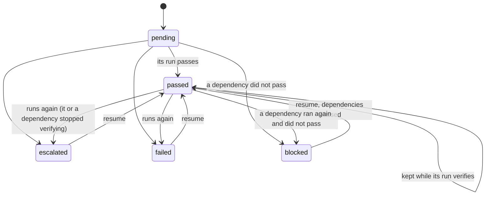

# The `a2dlc plan run` machine

Above the slice machine ([STATE_MACHINE.md](STATE_MACHINE.md)), a feature plan (RFC-0008) runs its slices in dependency order: `a2dlc plan run`, one invocation at a time, state in `.a2dlc/run/_plan/<feature>/state.json` (`contracts/plan-state.schema.json`). Generated from `internal/plan/fsm.go`; the model checker is `internal/plan/fsm_test.go` and the conformance test of the runner is `internal/plan/runner_test.go`.

Slice statuses in a plan: `pending`, `passed`, `escalated`, `failed`, `blocked`.

## Rules of one invocation

- **P1.** Slices are visited in topological order, ties broken by slice id; each invocation runs each slice at most once. A slice starts once every slice it depends on has settled in this invocation, so slices with no path between them run at the same time, up to the slots the host and the Docker daemon hold. What a slice ends in depends only on how the slices it depends on settled, so the statuses are those of the sequential machine; only the order slices start in can differ.
- **P2.** A slice runs only when every slice it depends on has passed, on a base that is the feature's base with those candidates merged in topological order.
- **P3.** A slice whose dependency did not pass is blocked, and so, transitively, is every slice that depends on it; nothing else is.
- **P4.** A passed slice whose run still verifies is kept; one that no longer verifies runs again, and so does every slice that depends on it (the plan-level redo).
- **P5.** An escalated, failed or blocked slice is visited again on the next invocation (resume).
- **P6.** The outcome is PASS when every slice passed and the merge of every candidate passes the final check; escalated when some slice escalated or the final merge or check did not pass; INCONCLUSIVE when some slice failed and none escalated.

## Invariants

- **J1.** No stale base: a passed slice finished no earlier than every slice it depends on.
- **J2.** A passed slice has every slice it depends on passed; a blocked slice has one that did not pass.
- **J3.** A failure blocks exactly its dependents: a slice that is not passed, escalated or failed is blocked if and only if some slice it depends on did not pass.
- **J4.** The outcome is PASS if and only if every slice passed and the final check of their merge passed.
- **J5.** An invocation over a plan whose slices all passed and still verify runs nothing.
- **J6.** An invocation runs each slice at most once, so every invocation terminates.

## What one invocation does on disk

- Each slice's intent is derived from the plan (`intents/<slice>.json`), with `boundary.allowed_paths` set to the slice's `owns`: a Builder change outside them escalates in Stage 3 (CB-04).
- A slice's base is the feature's base with the candidates of the slices it depends on merged in visit order (`git merge-tree`, no working tree touched). A merge has a fixed author and date, so the same inputs give the same commit and a resumed slice finds its run on the same base; a single dependency is a fast-forward. Bases and the final merge are kept under `refs/a2dlc/plan/<feature>/` so `git gc` does not drop them.
- Each slice runs as an `a2dlc run` in its own worktree, `<git common dir>/a2dlc-plan/<feature>/<slice>`: slices side by side never share a working tree, a `.a2dlc/verdict.json` or an `escalations.json`, and `git status` does not list the worktrees. The repository's `.a2dlc/roles.json` is copied in before each run. `run_dir` in the state says where a person answers an escalation.
- A slice whose run is on another base (a dependency ran again) has its old run moved to `superseded/` and starts a new one: a run never changes base.
- How many slices run at once is measured at the start of each invocation (`internal/resources`): the host that runs a2dlc (CPUs, capped by a cgroup quota on Linux, minus the load; memory available now) and the Docker daemon that runs the containers (`docker info`, minus what `docker stats` shows running; with Docker Desktop that is its VM, not the host). A slice's peak is read from the repository: the largest role of `roles.json`, the engines of `config.json` side by side, the tests, the checks, with the launcher's defaults where a limit is left out, plus a share of the host for a2dlc itself. Slots fill 90 % of what is free, at least one. `--jobs` or `A2DLC_PLAN_JOBS` overrides it; the state records the decision and why (`scheduler`).
- The final check is `a2dlc check` against the feature's base on the merged commit; its receipt is `final.json`, never `.a2dlc/verdict.json`. The plan's folder is under `.a2dlc/run`, so like a slice's run it stays out of the `tree_hash` (`gitx.Excluded`).
- A new version of the plan file (a replan, an edit) keeps the state of each slice whose definition, and that of every slice it depends on, did not change (`definition_sha256`); the rest start pending. Another base is refused: the person moves the old state aside to start over.
- A slice whose Builders are exhausted (CB-02b) is marked so in the state. With `--max-replan` above the replans already proposed and a `planner` role in `roles.json`, `plan run` asks the planner to split it; the split must pass the replan rules R1 to R4 and the plan gates, and is written next to the plan as `<plan>.replan-<n>.json`. Running it is the person's decision.

## Outside the model

- What a slice's run ends in: that is the slice machine's judgment.
- The resources a slice actually uses: the measurement admits slices by the limits they declare, which Docker enforces per container; it is taken once per invocation, so work started elsewhere during the invocation is not seen.

## How it is checked

- **Model checker** (`TestModelCheckPlanMachine`): every dependency graph on 4 slices (64 shapes, from four independent slices to a full chain), every outcome of every slice that runs, the final check passing or not, and a passed slice that stops verifying between invocations; breadth-first to a fixpoint, with invocations renumbered by rank.
- **Conformance** (`TestRunnerConformsToTheModel`): the real runner over the same graphs with scripted slice runs, real git merges and 1 to 3 slices at once; after each invocation, the slices it ran, their statuses and the outcome must be what the model predicts, no slice may start before a slice it depends on, and no more than the slots may run at once. A runner that starts a slice without waiting for its dependencies fails it on 59 of the 64 graphs.
- **End to end** (`internal/plan/exec_test.go`): three slices through real `a2dlc run`s in their worktrees, two of them side by side, with a fake Builder and engine; a tampered run re-runs its dependents; a Builder outside its `owns` escalates and blocks only its dependent; a Builder stuck at Tier 0 ends CB-02b and is marked for a replan.

## Replan rules

- **R1.** only the exhausted slice changes: it is gone, every other slice is as it was except for the edges that pointed at it
- **R2.** the sub-slices own a partition of what the exhausted slice owned: nothing outside it, and every file of it
- **R3.** the sub-slices depend only on what the exhausted slice depended on, or on each other
- **R4.** a slice that depended on the exhausted slice depends on every sub-slice no other sub-slice depends on
