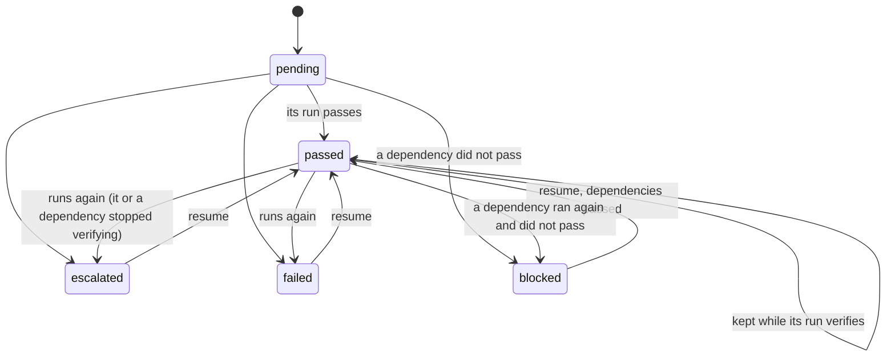

# The `a2dlc plan run` machine

Above the slice machine ([STATE_MACHINE.md](STATE_MACHINE.md)), a feature plan (RFC-0008) runs its slices in dependency order: `a2dlc plan run`, one invocation at a time, state in `.a2dlc/run/_plan/<feature>/state.json` (`contracts/plan-state.schema.json`). Generated from `internal/plan/fsm.go`; the model checker is `internal/plan/fsm_test.go` and the conformance test of the runner is `internal/plan/runner_test.go`.

Slice statuses in a plan: `pending`, `passed`, `escalated`, `failed`, `blocked`.

## Rules of one invocation

- **P1.** Slices are visited in topological order, ties broken by slice id; each invocation visits each slice at most once.
- **P2.** A slice runs only when every slice it depends on has passed, on a base that is the feature's base with those candidates merged in topological order.
- **P3.** A slice whose dependency did not pass is blocked, and so, transitively, is every slice that depends on it; nothing else is.
- **P4.** A passed slice whose run still verifies is kept; one that no longer verifies runs again, and so does every slice that depends on it (the plan-level redo).
- **P5.** An escalated, failed or blocked slice is visited again on the next invocation (resume).
- **P6.** The outcome is PASS when every slice passed and the merge of every candidate passes the final check; escalated when some slice escalated or the final merge or check did not pass; INCONCLUSIVE when some slice failed and none escalated.

## Invariants

- **J1.** No stale base: a passed slice finished no earlier than every slice it depends on.
- **J2.** A passed slice has every slice it depends on passed; a blocked slice has one that did not pass.
- **J3.** A failure blocks exactly its dependents: a slice that is not passed, escalated or failed is blocked if and only if some slice it depends on did not pass.
- **J4.** The outcome is PASS if and only if every slice passed and the final check of their merge passed.
- **J5.** An invocation over a plan whose slices all passed and still verify runs nothing.
- **J6.** An invocation runs each slice at most once, so every invocation terminates.

## What one invocation does on disk

- Each slice's intent is derived from the plan (`intents/<slice>.json`), with `boundary.allowed_paths` set to the slice's `owns`: a Builder change outside them escalates in Stage 3 (CB-04).
- A slice's base is the feature's base with the candidates of the slices it depends on merged in visit order (`git merge-tree`, no working tree touched). A merge has a fixed author and date, so the same inputs give the same commit and a resumed slice finds its run on the same base; a single dependency is a fast-forward. Bases and the final merge are kept under `refs/a2dlc/plan/<feature>/` so `git gc` does not drop them.
- A slice whose run is on another base (a dependency ran again) has its old run moved to `superseded/` and starts a new one: a run never changes base.
- The final check is `a2dlc check` against the feature's base on the merged commit; its receipt is `final.json`, never `.a2dlc/verdict.json`. The plan's folder is under `.a2dlc/run`, so like a slice's run it stays out of the `tree_hash` (`gitx.Excluded`).
- A changed plan file or another base is refused: the person moves the old state aside to start over.

## Outside the model

- Replanning on CB-02b (RFC-0008 P5) and slices of one level running at the same time: not implemented yet; slices run one after another.
- What a slice's run ends in: that is the slice machine's judgment.

## How it is checked

- **Model checker** (`TestModelCheckPlanMachine`): every dependency graph on 4 slices (64 shapes, from four independent slices to a full chain), every outcome of every slice that runs, the final check passing or not, and a passed slice that stops verifying between invocations; breadth-first to a fixpoint, with invocations renumbered by rank.
- **Conformance** (`TestRunnerConformsToTheModel`): the real runner over the same graphs with scripted slice runs and real git merges; after each invocation, the slices it ran, their order, their statuses and the outcome must be what the model predicts.
