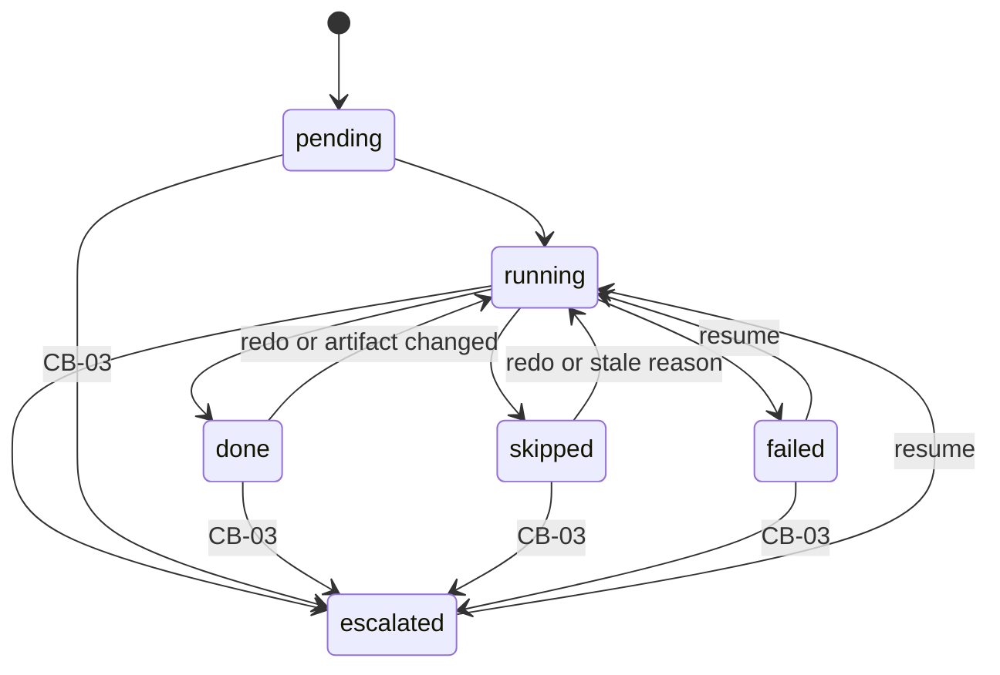

# The `a2dlc run` state machine

Generated from `internal/run/fsm.go` by `go test ./internal/run -run TestStateMachineDoc -update`; a test fails when this file and the code disagree. The same definition is what the model checker explores (`fsm_test.go`) and what the conformance test holds the real `Run` to (`fsm_conformance_test.go`).

## Stages

`-1` → `0` → `1` → `1.5` → `2` → `3` → `4` → `5` → `6` → `7`, in this order, every run. A stage that does not apply to the mode ends `skipped` with its reason.

## Stage statuses

| From | May go to |
|---|---|
| `pending` | `running`, `escalated` |
| `running` | `done`, `skipped`, `escalated`, `failed` |
| `done` | `running`, `escalated` |
| `skipped` | `running`, `escalated` |
| `escalated` | `running`, `escalated` |
| `failed` | `running`, `escalated` |

`escalated` is reachable from any status without running, through the budget breaker (R4).

## Rules of one invocation

- **R1.** Stages are visited in the fixed order of contract.Stages, one invocation at a time; each invocation visits each stage at most once.
- **R2.** Until some stage of this invocation has run, a stage that is done with its artifact intact is kept, and so is a stage that is skipped without an artifact whose reason the config has not made stale.
- **R3.** Any other stage runs. Once one stage of an invocation has run, every later stage of that invocation runs too (redo): a new result never sits on top of later results computed from an older one.
- **R4.** Before a stage runs, the budget breaker (CB-03) is checked: over the limit, the stage ends escalated with the budget reason, it is not called, and the invocation stops.
- **R5.** A stage that ends escalated sets the outcome to escalated; one that ends failed sets it to INCONCLUSIVE; in both cases the invocation stops and no later stage is visited.
- **R6.** A stage that ends done or skipped lets the invocation go on to the next stage; the outcome is set by the stages themselves (Stages 4 to 7 write PASS), not by Run.
- **R7.** Between invocations only the world changes: an artifact can be altered, a skip can become stale, the budget can be raised. The state on disk is the only memory.
- **R8.** Stage 0's artifact is the intent, and opening a run binds it: an intent changed since Stage 0 recorded it makes Run refuse to resume (delete the run's folder to start over), instead of re-running Stage 0 under the stages already judged against the old one.

## Invariants

Checked on every reachable state of the model, and on every state the real `Run` leaves on disk in the conformance test.

- **I1.** No stale result: along the stages, ignoring pending ones, the invocation that last finished each stage never decreases up to the first stage that is not done or skipped.
- **I2.** At most one stage is escalated or failed among those the last invocation visited, and it is the last one that invocation visited.
- **I3.** Every status change of a stage is in StageTransitions.
- **I4.** A stage never runs while the budget is exceeded.
- **I5.** An invocation visits at most as many stages as there are, so every invocation terminates.
- **I6.** An invocation over a state where every stage is done with an intact artifact, or skipped and not stale, runs nothing (resume is idempotent).
- **I7.** A stage that is done has an artifact: Run refuses a stage that ends done without one, because resume keeps a done stage by its artifact (R2) and verify-run requires it.

## How it is checked

- **Model checker** (`TestModelCheckRunMachine`): breadth-first search over every state the model reaches from a new run, through any number of invocations, with every outcome of every stage that runs, every point from which the budget breaker trips, and every world event between invocations; invocations are renumbered by rank, so the search reaches a fixpoint. By default 3 stages (3436 states, 450740 transitions, under a second); with `A2DLC_MODEL_STAGES=4`, 86841 states and 39919654 transitions (about two minutes). Every rule relates at most an earlier stage, the current one and a later one, which is why 3 is the default.
- **Conformance** (`TestRunConformsToTheModel`): 120 seeded traces of the real `Run` with every stage replaced by a scripted one; after each invocation the stages called, their order, the statuses, the artifacts and the outcome on disk must be what the model predicts, and the invariants must hold on disk. Breaking R3 in `machine.go` makes 77 of the 120 traces fail.
- **Self-test** (`TestModelCheckerCatchesAMachineWithoutRedo`): the invariants reject a machine that keeps a later stage after re-running an earlier one.

## Outside the model

- The loops inside a stage (Tier 0 rounds, Saboteur rounds, specification rounds): each is bounded by its own limit (`max_inner_iterations`, `--max-rounds`, `--max-spec-rounds`), so a stage terminates; their content is the stage's.
- Which outcome a stage produces: that is the stage's judgment (§5), not the machine's.
- The budget breaker in the conformance test: the model checks R4 and I4; the real breaker is covered by the run's budget tests, because its spend comes from the ledger.
- A feature of several slices: the plan machine above this one runs each slice through it, in dependency order ([PLAN_MACHINE.md](PLAN_MACHINE.md), RFC-0008).
